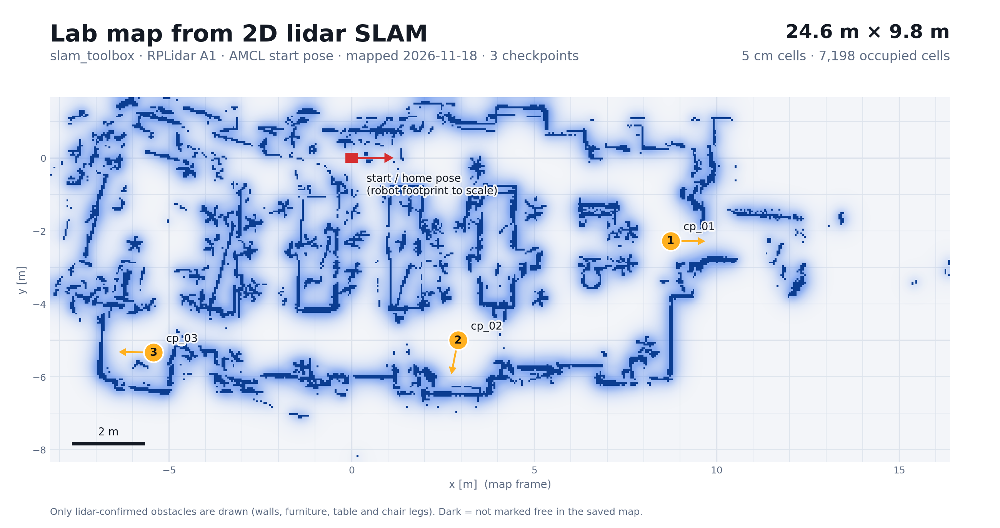

<div align="center">

# Safety Inspection Robot

**Autonomous checkpoint patrol and RGB-D hazard detection on a ROS 2 mobile robot**

[](https://github.com/Nirmalworks/safety-inspection-robot/actions/workflows/ci.yml)
[](https://docs.ros.org/en/humble/)
[](https://www.python.org/)
[](https://docs.nav2.org/)
[](https://developer.nvidia.com/embedded/jetson-nano)
[](LICENSE)

[Overview](#system-overview) ·
[Quick start](#quick-start-on-the-robot) ·
[Documentation](#documentation) ·
[Status](#project-status) ·
[Contributing](CONTRIBUTING.md)

<picture>
  <source media="(prefers-color-scheme: dark)" srcset="docs/progress/figures/map_lab_1118_dark.png">
  
</picture>

</div>

An autonomous mobile robot that patrols a fixed route in a building, stops at inspection
checkpoints, and checks each one for three safety hazards: **blocked exit**, **obstructed
walkway**, and **open door**. Each checkpoint result is logged with an annotated RGB-D image and
shown on a web dashboard so that facilities staff can review flagged locations.

Course project for AME 505 *Machine Learning for Engineering Applications* (USC, Fall 2026), Group 5.

## System overview

```
 lidar map ──► AMCL localization ──► Nav2 waypoint patrol ──► stop at checkpoint
                                                                     │
                                                                     ▼
 dashboard ◄── log + annotated image ◄── checkpoint decision ◄── RGB-D capture
                                              ▲
                          ┌───────────────────┴──────────────────┐
                 depth keep-clear rule (baseline)     YOLO detector + classifier (ML)
```

| Component | Method | Package / file |
|---|---|---|
| Mapping | slam_toolbox (2D lidar) | `launch/mapping_2d.launch.py` |
| Localization | AMCL, omnidirectional motion model; EKF (15 Hz) over wheel odometry and IMU | `launch/navigation_2d.launch.py`, `config/ekf.yaml` |
| Navigation | Nav2 (DWB controller, collision monitor, no-spin behaviour tree with a short reverse recovery) | `config/nav2_params.yaml`, `config/navigate_no_spin.xml` |
| Patrol | Nav2 simple commander, checkpoint list per map | `ame505_bringup/patrol.py` |
| Hazard baseline | Depth points projected to the robot frame; area inside the keep-clear zone | `ame505_bringup/keep_clear.py` |
| Object detection | Pretrained COCO YOLO26n (Ultralytics): live on the dashboard, offline over the dataset with CVAT pre-labels | `ame505_bringup/yolo_live.py`, `ml/yolo_coco.py` |
| Hazard model | YOLO fine-tuned from COCO, TensorRT on the Jetson; checkpoint classifier | in progress (`ml/`) |
| Operator UI | Flask + rclpy web dashboard (map, patrol, E-STOP, results, 3D URDF view, live YOLO) | `ame505_bringup/dashboard.py`, `web/index.html` |

## Hardware and software

* **Robot:** Hiwonder JetAuto: Jetson Nano 4 GB, mecanum base, RPLidar A1, Orbbec Astra RGB-D camera, IMU
* **Software:** Ubuntu 22.04, ROS 2 Humble, slam_toolbox, Nav2, OpenCV, Ultralytics YOLO, scikit-learn
* **Offline tools** (`ml/`): Python 3, NumPy, OpenCV, PyYAML. No ROS needed.

## Repository layout

```
safety-inspection-robot/
├── src/
│   ├── ame505_description/   URDF / xacro and meshes of the JetAuto
│   └── ame505_bringup/       launch files, Nav2 / SLAM configs, patrol, dataset capture, dashboard
├── maps/                     committed maps with their checkpoints / home (scripts/backup_map.sh)
├── ml/                       dataset split, depth-rule baseline, evaluation metrics, YOLO COCO tool, tests
├── gtsam_experiments/        stand-alone GTSAM pose-graph experiments
├── scripts/                  environment, dashboard, map export, debug bundle, stop-all
├── docs/                     setup, navigation, localization, data collection, developer guide
└── debug_logs/               trimmed logs and maps from robot sessions
```

## Quick start (on the robot)

```bash
source ~/ros2_ws/.robotrc && colcon build --symlink-install && ./scripts/setup_ssd_data.sh   # once
source scripts/env.sh                                                                         # every terminal
./scripts/dashboard.sh            # web UI at http://<robot-ip>:8505
```

From the dashboard: start mapping, then stop and save the map, start navigation, save checkpoints,
and run the patrol. Equivalent command-line steps:

```bash
ros2 launch ame505_bringup mapping_2d.launch.py map:=lab2d        # build a 2D map (Xbox: hold LB to drive)
./scripts/save_2d_map.sh lab2d                                    # save it while mapping runs
ros2 launch ame505_bringup navigation_2d.launch.py map:=lab2d     # AMCL + Nav2 (Xbox Y saves a checkpoint)
ros2 run ame505_bringup patrol --map lab2d                        # visit every checkpoint
ros2 run ame505_bringup capture_dataset --session s1 --checkpoint cp_01 --scene normal --n 6
./scripts/stop_all.sh                                             # stop all nodes and zero the motors
```

## Documentation

| Document | Contents |
|---|---|
| [docs/ROBOT.md](docs/ROBOT.md) | Hardware, software layout on the robot, working from a laptop |
| [docs/MAPPING_NAVIGATION.md](docs/MAPPING_NAVIGATION.md) | Step-by-step mapping, localization, navigation, patrol |
| [docs/LOCALIZATION.md](docs/LOCALIZATION.md) | Localization failure analysis and the AMCL configuration |
| [docs/JETSON_MEMORY.md](docs/JETSON_MEMORY.md) | Freeing RAM on the Jetson Nano: per-session cleanup script and one-time host settings |
| [docs/LAB_SESSION.md](docs/LAB_SESSION.md) | **Next robot session runbook:** re-map, checkpoints, camera calibration, first patrol, dataset S1 |
| [docs/DATA_COLLECTION.md](docs/DATA_COLLECTION.md) | RGB-D dataset protocol: checkpoints, scenes, sessions, splits |
| [docs/DEVELOPMENT.md](docs/DEVELOPMENT.md) | Build / run, TF tree, Jetson Nano constraints, code map |
| [docs/SIMULATION.md](docs/SIMULATION.md) | Run mapping, navigation and patrol on a laptop against a simulated base and lidar |
| [docs/ROBOT_SESSION_CHECKLIST.md](docs/ROBOT_SESSION_CHECKLIST.md) | Checklist for a robot test session: data to record, map, checkpoints |
| [ml/README.md](ml/README.md) | Dataset split, depth-rule baseline, evaluation metrics |
| [docs/GTSAM_SLAM.md](docs/GTSAM_SLAM.md) | Experimental GTSAM lidar / gyro SLAM |
| [gtsam_experiments/README.md](gtsam_experiments/README.md) | Stand-alone GTSAM pose-graph experiments and hardware guide |

## Project status

| Area | Status |
|---|---|
| 2D lidar mapping (slam_toolbox) | Working on the robot |
| AMCL localization + EKF | Working on the robot |
| Nav2 checkpoint patrol | Working on the robot and in simulation |
| Operator dashboard + E-STOP | Working on the robot |
| Pretrained COCO YOLO (live) | Running on the robot |
| Depth keep-clear baseline | Implemented; evaluated on synthetic scenes only |
| RGB-D hazard dataset | Collection protocol ready ([docs/DATA_COLLECTION.md](docs/DATA_COLLECTION.md)) |
| Fine-tuned hazard detector + classifier | In progress |

## Contributing

Work happens on topic branches merged into `dev`; `dev` is merged into `main` after review.
See [CONTRIBUTING.md](CONTRIBUTING.md) for the branch model, commit style, and the checks CI runs.

## Team

Leo Crampe (evaluation) · Nirmal Kumar Jagannathan (system integration) ·
Ryan O'Gorman (data preparation) · Soowhan Yi (model development)

## License

Released under the [Apache License 2.0](LICENSE). The JetAuto URDF and meshes in
`src/ame505_description` are adapted from the Hiwonder JetAuto description.

## Citation

If this work is useful to you, cite it with the metadata in [CITATION.cff](CITATION.cff)
(GitHub: **Cite this repository** in the sidebar).
