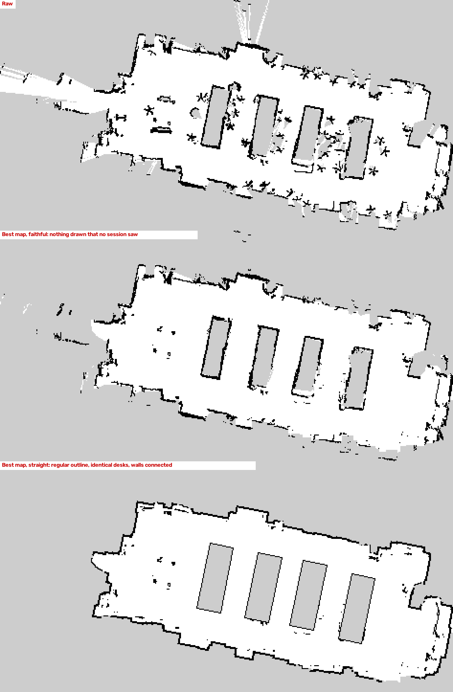
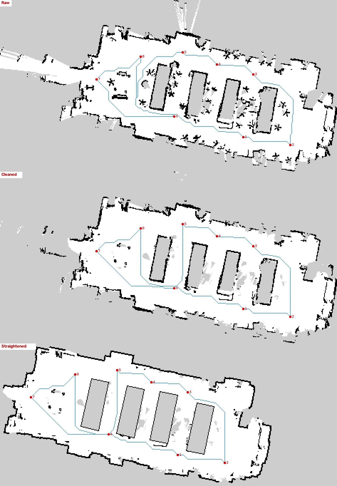

# Map cleaning: results (27 Nov 2026)

Question: can an ML model turn a raw 2D lidar occupancy map into a clean one the robot can use?

Answer: yes for the lab, when the task is framed as erasing cells and a few maps of the room are hand-labelled.
It does not yet carry over to other buildings.

Code: `ml/map_clean/`, labelling tool: `scripts/map_labeler.py`. Data, models and raw result files are in
`data/map_cleaning/` (git-ignored). Maps are Nav2 trinary maps at 0.05 m per cell.

## The maps for the robot

`maps/lab2d_11_25_5/maps_2d_cleaned/` holds five candidates on the same grid and origin as the raw map, so the
checkpoints in `maps/lab2d_11_25_5/checkpoints/` apply unchanged.

| File | What it is |
|---|---|
| `lab2d_11_25_5_best` | Everything combined, straightened and enclosed; see "The best map" below |
| `lab2d_11_25_5_best_faithful` | Everything combined, nothing drawn that no session saw |
| `lab2d_11_25_5_model_only` | The general model fine-tuned on lab maps of other days, applied to the raw map, then the door-leak rule. The model never saw a 25 Nov map and its threshold was set on a 24 Nov map, so no hand label of this map or its day is used: 99.2 % of structure kept, 77.4 % of clutter removed (54 structure cells lost, 247 clutter cells left) |
| `lab2d_11_25_5_cleaned` | Hand labels where given (4,750 of 5,741 occupied cells), the lab model for the 991 cells left unsure, floor that leaked through the door cut off |
| `lab2d_11_25_5_straightened` | The cleaned map with a regular outer wall and the four benches drawn as identical rectangles (3.45 x 1.25 m) |


In all three, unseen patches inside the room (lidar shadows behind furniture, and notches in the wall whose opening
to the outside is narrower than the robot, 2.5 m2 in total) are turned into floor; bench interiors, the insides of
solid objects and openings wider than 35 cm stay unknown (`ml/map_clean/fill_unknown.py`). No wall is drawn across a
notch. The planning check gives
the same routes with and without this step.

Which map the robot drives on is left open until the live test on 30 Nov (raw, `best_faithful`, `best` and
`model_only` are driven; `cleaned` is optional). Before the best maps existed `cleaned` was the recommendation, because
nothing real is missing from it. `model_only` is what the ML produces
unaided. `straightened` is the polished version, to be used once a live run confirms it. None has been driven live yet.
One object marked keep, 15 cells at about (-6.57, 4.47) in the map frame, is erased in `model_only`; the planned leg from checkpoint 7 to 8 passes 10 cm from it.

## The best map: everything combined

`maps/lab2d_11_25_5/maps_2d_cleaned/lab2d_11_25_5_best` (and `_best_faithful`), made by `ml/map_clean/best_map.py`.



1. **Decide every occupied cell with the model and the other days together.** Erase when the model says erase and
   fewer than 85 % of the other days' sessions have a wall there, or when fewer than 20 % of them have one. The model
   is the mean of the two fine-tuned copies that never saw 25 Nov. With a day held out on the four hand-labelled maps
   this rule keeps 98.3 % of structure (worst map 98.0 %) and removes 77.1 % of clutter (worst 69.8 %); the model
   alone gives 96.6 % (94.8 %) and 73.9 % (69.0 %).
2. **Hand labels overrule.** The map's own labels, then labels of the three other labelled sessions carried to the
   same place. They changed the decision on 359 of 5,741 cells.
3. **Cut the door leak** (9.0 m2).
4. **Use what the other 16 sessions saw where this one saw nothing,** inside the room only: 1.97 m2 of floor that
   most sessions show, and 92 wall cells that at least half the sessions have at exactly that cell and that no hand
   label calls clutter. Mostly bench edges hidden behind chairs on that day.
5. `_best_faithful` stops here, with the remaining 1.0 m2 of unseen patches turned into floor. Nothing in it was
   drawn that no session saw.
6. `_best` goes on: the four benches as identical rectangles (3.45 x 1.25 m), the outer wall regularised along the
   room's two directions, 10 gaps in it closed with 88 drawn wall cells (one opening of 1.8 m is left), the inside
   known except the benches.

| Map | Structure within 10 / 20 cm | Clutter removed | Tour | Route cells too close to real structure | AMCL, drive from another session |
|---|---|---|---|---|---|
| Raw | 100 % / 100 % | 0 % | 47.6 m | 0 | 18.8 cm |
| Best, faithful | 100 % / 100 % | 94.8 % | 42.3 m | 0 | 19.8 cm |
| Best (straight) | 71.1 % / 92.9 % | 90.7 % | 42.6 m | 0 | 18.0 cm |
| Best, faithful, built blind (mean of 4 maps) | 98.7 % / 99.6 % | 72.8 % | | | |
| Best, straight, built blind (mean of 4 maps) | 76.9 % / 92.4 % | 73.0 % | | | |

The first three rows are the robot's map; its own hand labels are used, so those scores are high by construction.
"Built blind" is the fair test of the whole recipe (`build(..., blind=True)`): for each of the four labelled maps the
best map is built without that map's labels or any label from its day. Blind, the faithful form keeps more structure
than the model alone (98.7 % against 96.6 %; worst map 98.1 %) and removes about as much clutter (72.8 % against
73.9 %; worst map 62.2 %). The straight version moves walls and bench edges by up to 20 cm and
draws wall where no session saw one. AMCL differences of a centimetre are within what one replay can show.

## The model

- Erase only: for every occupied cell the network outputs the probability that it is movable clutter. Cells above a
  threshold are erased (to floor if floor touches them, otherwise to unknown). It cannot draw or move a wall.
- U-Net, about 11 M parameters, input 3 x 256 x 256 (free / occupied / unknown), output one erase score per cell.
- Labels per occupied cell: keep, erase, or unsure (ignored). Sources: hand labels (browser tool), hand labels
  carried to the same place in other aligned sessions, agreement between sessions, and in simulation the object each
  ray hit.
- Loss: binary cross-entropy on labelled occupied cells, a keep cell weighted 3 times an erase cell. AdamW, learning
  rate 2e-4, batch 32. Lab maps are cropped at random positions and angles.
- Lab model: 14 real lab maps from four days for the robot's model, 8 (the maps of the other days) for each
  day-held-out model; 20 epochs of 300 steps, about 30 minutes on one L40S.
- General model: 81,458 simulated patches from every HouseExpo house and every KTH room (no rooms invented by code,
  205 degree lidar, simulated drift, noise, dropouts and clutter), 10 epochs, 90 minutes.
- Threshold: the highest-removal setting that keeps 95 % of structure on a separate hand-labelled validation map.

## Scoreboard: every method tried

Scoring (changed on 26 Nov; the first version counted structure only on the exact cell, which is unfair to methods
that redraw walls):

- Structure kept: a cell hand-marked keep counts if the output has an occupied cell within 10 cm. Mark: >= 95 %.
- Clutter removed: a cell hand-marked erase counts if no occupied cell is left within 5 cm. Mark: >= 60 %.
- Invented walls: occupied cells with no raw wall within 10 cm.
- Lab, 4 maps: mean over the four hand-labelled maps. For anything trained on lab maps, each map is scored by a model
  that never saw any map of that day (4 models, 8 tests). This is the column to compare.

One row per method or model, 34 in all; the last 22 were added and every column filled on 26 and 27 Nov. Test map
`lab2d_11_25_7`: 2,913 keep, 1,386 erase, 677 unsure cells. AMCL error is on a drive of the mapping session itself.

| Method | Lab, 4 maps: kept / removed (worst test) | Invented cells, 4-map mean | Test map 25_7: kept / removed | MIT Stata, 14 pieces: kept / removed | AMCL error, same-session drive |
|---|---|---|---|---|---|
| **Starting point** | | | | | |
| Raw map | 100 % / 0 % | 0 | 100 % / 0 % | 100 % / 0 % | 4.8 cm |
| **Without ML** | | | | | |
| Speckle filter | 96.7 % / 10.1 % | 0 | 96.6 % / 10.9 % | 96.8 % / 27.1 % | 4.2 cm |
| ROSE2, filter 0.10 | 99.3 % / 5.6 % | 0 | 99.0 % / 5.5 % | 88.0 % / 38.5 % | 4.9 cm |
| ROSE2, filter 0.14 | 98.5 % / 13.4 % | 0 | 98.4 % / 14.1 % | 80.2 % / 60.3 % | 4.9 cm |
| ROSE2, filter 0.18 (default) | 96.0 % / 26.3 % | 0 | 96.3 % / 27.3 % | 72.2 % / 76.1 % | 5.0 cm |
| ROSE2, filter 0.22 | 92.1 % / 42.7 % | 0 | 91.7 % / 43.9 % | 65.3 % / 85.7 % | 5.5 cm |
| ROSE2, filter 0.26 | 86.5 % / 59.0 % | 0 | 86.2 % / 58.3 % | 59.1 % / 91.1 % | 5.8 cm |
| ROSE2, filter 0.30 | 79.4 % / 72.7 % | 0 | 80.4 % / 69.7 % | 53.7 % / 95.1 % | 7.0 cm |
| Session agreement, cautious | 100 % / 11.1 % | 0 | 100 % / 20.2 % | needs several sessions | 5.2 cm |
| Session agreement, aggressive | 94.0 % / 53.4 % | 0 | 91.4 % / 66.7 % | needs several sessions | 9.8 cm |
| Vote of the other sessions | 91.7 % / 62.9 % | 421 | 79.2 % / 77.2 % | needs several sessions | 17.7 cm |
| **First generation: redraws the map; 15,930 simulated pairs, 60 % rooms generated by code; never saw the lab** | | | | | |
| First model (`unet_ce`) | 74.6 % / 91.1 % (69.5 / 89.2) | 306 | 73.5 % / 93.3 % | 89.8 % / 50.9 % | 14.9 cm, lost at the end |
| First model, fully synthetic pairs (`unet_ce_synth`) | 76.8 % / 90.6 % (70.2 / 88.3) | 257 | 77.7 % / 93.7 % | 90.2 % / 47.0 % | 9.6 cm, lost at the end |
| First model with a GAN loss (`unet_gan`) | 72.9 % / 91.7 % (67.3 / 89.6) | 288 | 72.7 % / 92.4 % | 89.7 % / 50.1 % | 16.2 cm, lost at the end |
| First model + guardrail from the other sessions | 91.1 % / 79.9 % (90.2 / 76.5) | 306 | 91.6 % / 77.8 % | needs several sessions | 10.0 cm |
| **Erase-only, no lab maps in training; lab column with a threshold set on a hand-labelled lab map of the other day, other columns with the model's own threshold** | | | | | |
| Simulated floor plans only (`general_sim`) | 97.1 % / 51.3 % (94.8 / 0.0) | 0 | 69.9 % / 96.5 % | 91.3 % / 52.9 % | 17.9 cm |
| Semantic2D real maps only (`s2d_real`) | 96.8 % / 6.1 % (94.4 / 3.5) | 0 | 93.9 % / 7.4 % | 97.8 % / 9.9 % | 4.6 cm |
| Simulated + Semantic2D (`s2d_simreal`) | 96.0 % / 66.3 % (88.2 / 50.4) | 0 | 66.9 % / 95.5 % | 96.6 % / 29.0 % | 9.6 cm |
| Simulated + 11 real maps, trained together (`joint_real`) | 96.6 % / 62.6 % (94.3 / 53.6) | 0 | 71.0 % / 97.5 % | 95.7 % / 34.9 % | 10.2 cm, lost at the end |
| Simulated, then 2 Radish buildings (`radish_ft`) | 96.0 % / 52.7 % (89.9 / 0.0) | 0 | 95.5 % / 78.2 % | 98.1 % / 23.7 % | 7.4 cm |
| **Erase-only, lab maps of other days in training; day held out** | | | | | |
| Lab only, run 1 (`fold_*`; robot's model `lab`) | 97.3 % / 68.0 % (95.1 / 64.2) | 0 | 96.4 % / 77.7 % | 92.5 % / 26.9 % | 7.6 cm |
| Lab only, run 2 (`fold_*_s1`) | 97.4 % / 65.4 % (95.7 / 56.6) | 0 | 97.9 % / 59.0 % | 95.3 % / 21.1 % | 6.4 cm |
| **Simulated then lab, run 1** (`ftfold_*`; robot's model `general_ft`) | **96.6 % / 73.9 %** (94.6 / 67.7) | 0 | 96.8 % / 79.6 % | 96.9 % / 32.9 % | 8.3 cm |
| Simulated then lab, run 2 (`ftfold_*_s1`) | 97.0 % / 71.0 % (94.9 / 65.7) | 0 | 97.0 % / 71.7 % | 98.1 % / 24.1 % | 6.6 cm |
| Simulated then lab, run 3 (`ftfold_*_s2`) | 96.5 % / 74.5 % (94.2 / 69.5) | 0 | 96.5 % / 72.7 % | 97.6 % / 27.8 % | 7.2 cm |
| Simulated then lab, run 1, keep target 0.96 | 97.5 % / 66.4 % (95.8 / 56.0) | 0 | 97.6 % / 68.2 % | 98.3 % / 22.3 % | 5.9 cm |
| Simulated then lab, run 1, keep target 0.97 | 98.3 % / 57.0 % (96.7 / 39.7) | 0 | 97.9 % / 62.0 % | 98.9 % / 16.9 % | 6.2 cm |
| Simulated + Semantic2D, then lab (`s2dft_*`) | 96.8 % / 72.8 % (94.1 / 64.9) | 0 | 96.4 % / 69.8 % | 97.4 % / 25.8 % | 6.7 cm |
| **Generative: redraws the map, trained on the erase-only data; no threshold** | | | | | |
| Generative, simulated only (`redraw_sim`) | 87.6 % / 85.8 % (83.0 / 80.2) | 0 | 89.6 % / 90.0 % | 97.4 % / 27.3 % | 7.8 cm |
| Generative, simulated then lab (`redrawft_*`) | 97.7 % / 69.2 % (95.5 / 57.7) | 0 | 97.9 % / 73.8 % | 98.6 % / 18.1 %, about 100 invented cells | 8.4 cm |
| **Combinations** | | | | | |
| Erase-only lab model + the cells ROSE2 keeps | 99.8 % / 19.0 % | 0 | 99.5 % / 23.7 % | 97.4 % / 23.4 % | 4.5 cm |
| Simulated then lab + the other days' sessions (decision step only) | 98.3 % / 77.1 % (98.0 / 69.8) | 0 | 97.7 % / 81.0 % | needs several sessions | 8.7 cm |
| Best map recipe, faithful, built blind | 98.7 % / 72.8 % (98.1 / 62.2) | 13 | 99.3 % / 71.6 % | needs several sessions | 7.4 cm |
| Best map recipe, straight, built blind | 76.9 % / 73.0 % (72.5 / 60.8) | 485 | 80.5 % / 73.2 % | needs several sessions | 8.0 cm |

- Both marks are passed on average by 12 rows: every erase-only model with lab maps in training except the 0.97 keep
  target, the generative model after its lab stage, the two no-lab models that mix real maps with simulated ones, and
  the two sessions-based combinations that do not straighten. No method without ML passes.
- The best row is the erase-only model trained on simulated floor plans and then on lab maps: 96.6 % / 73.9 %, and
  96.5 to 97.0 % / 71.0 to 74.5 % over three runs.
- Models without lab maps need a threshold from somewhere. With one set on a lab map of the other day, simulated only
  removes nothing on its worst tests, because its scores pile up near 1. Mixing real maps into training steadies that
  (62.6 % and 66.3 % against 51.3 %). It does not help in other buildings.
- A stricter keep target buys structure at a steep price in clutter: 0.96 costs 7.5 points of removal, 0.97 costs 17.
- In MIT Stata nothing passes both marks. Among rows that keep 95 % of structure the most clutter removed is 34.9 %.
  ROSE2 only trades one mark for the other there. The labels come from floor plans without furniture, so fixed
  furniture counts as clutter.
- Localisation: every erase-only model with lab maps stays between 5.9 and 8.3 cm on the same-session drive (raw:
  4.8 cm; a map cleaned exactly to the hand labels: 7.9 cm, because the chairs stood as mapped and acted as landmarks).
  The three first-generation models end the drive lost.
- The generative model invents nothing in the lab and about 100 wall cells across the MIT Stata pieces.
- Basis of the last three columns for lab-trained models: models that never saw 25 Nov, except the two run 1 rows,
  which were scored on 26 Nov with the robot's own models (`lab`, `general_ft`; these trained on maps of the test day,
  at thresholds 0.26 and 0.21). On the stricter basis those two score 97.7 % / 64.9 % and 97.0 % / 73.2 % on the test
  map, and 94.6 % / 25.7 % and 97.7 % / 27.6 % in MIT Stata. Models without lab maps use their own threshold there.
- Correction: until 27 Nov this table showed the first model at 77.7 % / 93.7 % and 9.6 cm on the test map. Those
  figures belong to its fully synthetic variant.
- The MIT Stata pieces are the 14 that ROSE2 was run on (`data/map_cleaning/rose_fill/in/`).
- The tolerance is a choice: at 5 cm ROSE2 drops to 93.2 %, at 20 cm the first model with guardrail reaches 95.3 %.
- The hand labels started from session-agreement proposals, so they are not independent of the methods scored.
- The two blind best-map rows were rebuilt on 27 Nov for the replay; their test-map figures differ slightly from the
  26 Nov ones (99.0 % / 75.1 % and 79.6 % / 75.8 %), probably because a hand label for a 23 Nov map was added since.
- Tried and not on this board: the three models of the very first training run (scored only by an older wall-F1
  measure), a lab-only model retrained after a label revision (`lab2`), and a trial on automatic pre-labels.


## Day held out (the number to quote)

Exact-cell scoring, with the threshold moved to compare models at one operating point. Four lab models. Two never see any 25 Nov map and are scored on the two hand-labelled 25 Nov maps; two never see
24 Nov. Carried-over labels are rebuilt per model, so no hand label of the held-out day is used.

| | Mean | Range over 8 tests |
|---|---|---|
| Clutter removed at exactly 95 % structure kept | 75.4 % | 64.6 to 90.2 % |
| Ranking score (AUC) | 0.93 | 0.86 to 0.97 |
| Structure kept, threshold from validation | 95.8 % | 92.2 to 99.0 % |
| Clutter removed, threshold from validation | 73.1 % | 68.0 to 81.9 % |

Safety margin on the threshold (keep target on the validation map):

| Keep target | Structure kept: mean / worst | Tests below 95 % | Clutter removed: mean / worst |
|---|---|---|---|
| 0.95 | 95.8 % / 92.2 % | 3 of 8 | 73.1 % / 68.0 % |
| 0.96 | 96.6 % / 93.6 % | 2 of 8 | 68.6 % / 63.3 % |
| 0.97 | 98.0 % / 95.8 % | 0 of 8 | 47.7 % / 0.0 % |

A margin that guarantees 95 % on every test costs a third of the clutter removal, and for one model removes nothing.
The threshold stays at the 0.95 target.

## Other buildings

Clutter removed when the threshold is placed to keep exactly 95 % of structure, exact-cell scoring (ranking score in
brackets). All rows re-scored on 27 Nov on one basis: the 22 MIT Stata pieces with at least 1,500 labelled cells.

| Erase-only model trained on | MIT Stata, 22 pieces | Semantic2D, 2 held-out Temple lobbies | Lab, 4 hand-labelled maps |
|---|---|---|---|
| Simulated floor plans only | 37.0 % (0.82) | 21.0 % (0.72) | 70.7 % (0.93) |
| Semantic2D only (9 real labelled maps) | 13.4 % (0.64) | 14.4 % (0.66) | 9.2 % (0.74) |
| Simulated + Semantic2D | 29.9 % (0.78) | 19.7 % (0.70) | 70.4 % (0.93) |
| Simulated + 11 real maps, trained together | 33.5 % (0.81) | 19.6 % (0.72) | 67.9 % (0.93) |
| Simulated, then 2 hand-corrected Radish buildings | 33.7 % (0.70) | 4.9 % (0.55) | 71.7 % (0.92) |
| Simulated, then our lab | 36.2 % (0.75) | 4.3 % (0.48) | 80.0 % (0.94), day held out |
| Our lab only | 16.6 % (0.71) | 6.0 % (0.55) | 75.4 % (0.93), day held out |

- The model trained only on simulated floor plans ranks the lab's cells as well as models trained in the lab. Its
  threshold is fragile (scores pile up near 1), so the lab-trained model is the one used for the robot.
- Real labelled maps from other buildings did not improve any test in a building the model had not seen, whether used
  alone, added after the simulated stage or mixed into it (9 Semantic2D maps and Bremen and Stanford Gates from
  Radish, 30 % of each batch). Semantic2D has little clutter: 3.8 % of its occupied cells.
- Fine-tuning on one place costs the others: after the lab stage the Temple lobbies fall to chance.
- In buildings no model has seen, at most 37 % of clutter is removed.
- Earlier versions of this table used 14 pieces for some rows and one lab map for two rows; the figures differ by up
  to 2 points.

## Localisation (AMCL replay)

The recorded scan and odometry of the 25 Nov drive (session `lab2d_11_25_7`) played into Nav2's AMCL; error against
the pose slam_toolbox recorded.

| Map | Drive relative to the map | Mean error |
|---|---|---|
| 25 Nov map 7, raw | same session | 4.8 cm |
| 25 Nov map 7, lab model | same session | 7.6 cm |
| 25 Nov map 7, cleaned exactly to the hand labels | same session | 7.9 cm |
| 24 Nov map 3, raw / hand-cleaned | next day | 15.5 / 13.6 cm |
| 24 Nov map 8, raw / hand-cleaned | next day | 12.4 / 14.3 cm |
| Robot map (25 Nov map 5), raw | another session | 18.8 cm |
| Robot map, cleaned | another session | 18.7 cm |
| Robot map, model only | another session | 18.5 cm |
| Robot map, straightened | another session | 17.3 cm |

- In the mapping session itself the chairs stand where the raw map shows them and act as landmarks; a perfectly
  cleaned map scores no better than the model's. The 3 cm gap is not caused by model mistakes.
- When the drive comes from another session, most of the 12 to 19 cm is the error of lining up two sessions' maps.
  Only rows of the same map compare. There cleaning and straightening make no clear difference.
- One drive, one run per map. A drive recorded on the final map is still needed.

## Planning check

Shortest routes through the eight checkpoints and back on a grid version of the global planner: drivable = free and
at least 22 cm (the robot's half diagonal) from any occupied cell; unknown is not drivable.

| Map | Legs with a route | Tour length | Route cells within 22 cm of structure hand-marked keep |
|---|---|---|---|
| Raw | 8 of 8 | 47.6 m | 0 |
| Model only | 8 of 8 | 42.3 m | 13 (one erased object on the leg from checkpoint 7 to 8) |
| Cleaned | 8 of 8 | 42.3 m | 0 |
| Straightened | 8 of 8 | 42.5 m | 0 |



Removing clutter shortens the tour by 5 m. An earlier straightened version with benches drawn at 3.05 x 1.12 m let
routes pass within the robot's radius of real bench edges; the rectangles now use the largest measured extent.

## Checks added on 26 and 27 Nov

Day held out, scoreboard scoring; each row is four models on the two hand-labelled maps of the day they never saw.

| Model | Structure kept: mean (worst test) | Clutter removed: mean (worst test) | Clutter removed at exactly 95 % kept: mean (range) |
|---|---|---|---|
| Simulated, then lab: first run | 96.6 % (94.6 %) | 73.9 % (67.7 %) | 80.0 % (66.0 to 92.4 %) |
| Simulated, then lab: seed 1 | 97.0 % (94.9 %) | 71.0 % (65.7 %) | 80.3 % (65.8 to 94.0 %) |
| Simulated, then lab: seed 2 | 96.5 % (94.2 %) | 74.5 % (69.5 %) | 78.1 % (68.3 to 92.5 %) |
| Simulated + Semantic2D, then lab | 96.8 % (94.1 %) | 72.8 % (64.9 %) | 78.0 % (67.6 to 90.7 %) |
| Lab only: first run | 97.3 % (95.1 %) | 68.0 % (64.2 %) | 75.4 % (64.6 to 90.2 %) |
| Lab only: seed 1 | 97.4 % (95.7 %) | 65.4 % (56.6 %) | 75.4 % (65.5 to 87.8 %) |

- The lab result is not luck of one run: over three runs the fine-tuned model keeps 96.7 % and removes 73.1 % on
  average, and runs differ by 3.5 points of clutter removal.
- Starting the fine-tune from the model that also saw Semantic2D lands inside that spread.
- Starting from the simulated model helps: the two lab-only runs remove 65.4 and 68.0 %, the three fine-tuned runs
  71.0 to 74.5 %.

Joint training on simulated and real maps (`joint_real`) is in the "Other buildings" table: slightly below simulated
only on every test.

Generative model on the data of the erase-only model (`redraw.py`: three outputs per cell, free to change any cell,
target = the input with its clutter cells removed; trained from scratch on the simulated patches, then on the lab with
a day held out):

| Model | Structure kept: mean (worst test) | Clutter removed: mean (worst test) | Invented wall cells |
|---|---|---|---|
| Erase-only, simulated then lab, three runs | 96.7 % (94.2 %) | 73.1 % (65.7 %) | 0 |
| Generative, simulated then lab, one run | 97.7 % (95.5 %) | 69.2 % (57.7 %) | 0 |
| Generative, simulated only | 87.6 % (83.0 %) | 85.8 % (80.2 %) | 0 |
| First model | 74.6 % | 91.1 % | 306 |

Given these targets the generative model only erases in the lab and passes both marks on average after its lab stage.
So the first model did not fail because it redrew. What made it fail is not separated: its data (fewer pairs, 60 %
generated rooms), its targets (simulated clean maps) and the absence of real lab maps all changed together.
Erase-only stays the choice: about 4 points more clutter removed (close to the run-to-run spread; the generative model
was trained once), a better worst case, no invented wall by construction, and a threshold that sets the trade-off.

ROSE2 at other filter settings, mean over the four hand-labelled lab maps (kept / removed): 0.10: 99.3 % / 5.6 %;
0.14: 98.5 % / 13.4 %; 0.18 (default): 96.0 % / 26.3 %; 0.22: 92.1 % / 42.7 %; 0.26: 86.5 % / 59.0 %;
0.30: 79.4 % / 72.7 %. No setting passes both marks.

A third run of the lab-only model was dropped. Scoring scripts and raw figures are in `data/map_cleaning/folds/`, which is
not in the repo: `score_evening*.py`, `score_all_methods.py`, `fill_gaps.py` and their `.json` outputs; the AMCL replays
of 27 Nov are in `data/map_cleaning/amcl_fill/`.

The hand label of `lab2d_11_25_7` was revised on 26 Nov at 18:13 (341 unsure cells decided). Every figure in this
file uses the earlier label (`labels/archive/lab2d_11_25_7_label_original_20261125.png`); with the revised one the
figures in the first table move by at most 0.6 points.

## Next step

After the robot test: fine-tune on a few hand-labelled maps of a second building and test there, for the erase-only and
the generative model. In the lab a handful of labelled maps of the room is what took the model from failing to passing;
whether the same works in a new place is untested. It needs several mapping sessions of a second place, a few of them
labelled by hand, with a day held out.

## Limits

- One room. The fine-tuned model was trained three times (3.5 points of spread in clutter removal), the others once;
  differences of a few points between models are not established.
- The robot's map is mostly decided by hand labels; the model's own performance is the day-held-out result.
- The straightened map moves walls and bench edges by up to 10 to 20 cm; 68 % of hand-kept cells have a wall within
  10 cm, 91 % within 20 cm. No tape measurement of the room exists to check it against.
- The planning check is not Nav2 itself, and nothing has been driven live on the cleaned or straightened map.
- Session agreement, used for part of the training labels, cannot tell fixed furniture from furniture that never moved.

## Live demo in the map editor

`scripts/map_labeler.py` has a second toolbar. A method button marks the whole map keep / erase; the marks can be
corrected by hand; the clean-up buttons and "Show result" give the map those marks produce, scored against the saved
hand labels; "Export map" writes it to `data/map_cleaning/exports/`.

1. Without ML: raw, speckle filter, session agreement (cautious / aggressive), the vote of the other sessions (a new
   map, shown in the result view), ROSE2 (loaded from a file made
   beforehand in `data/map_cleaning/rose2/`, since ROSE2 runs in its own container).
2. With ML: the earlier model (its own redrawn map is shown in the result view), the fine-tuned general
   model, the lab model, the general model. Computed when the button is pressed; needs PyTorch and the model files in
   `data/map_cleaning/models2/`.
3. Everything combined: the best map, faithful or straight (`best_map.py`), shown in the result view.
4. Clean-up: cut door leak, straighten, fill unseen patches, connect walls (gaps in the outer wall up to 1.5 m are
   drawn as wall, a doorway included, and everything inside becomes floor except the desks; `connect_walls.py`).

Choose a place, then a map. A place is one building; its maps are sessions or drives of that building. "Our lab"
comes first; each folder `data/map_cleaning/unseen/<id>/` with `maps/` (and `labels/`, `title.txt`) is one more place. On those the speckle
filter and the models run; session agreement, the vote and the best map need other sessions of the same
room and do not appear. Scores show only where a `<name>_label.png` exists.

## Reproduce

```
# map editor (http://127.0.0.1:8507): hand labels, and buttons that run each method and the clean-up steps live
python3 scripts/map_labeler.py --desk-size 3.45 1.25
# train the lab model, then clean a map
python -m ml.map_clean.erase train --name lab --lab-val lab2d_11_25_5 --lab-test lab2d_11_25_7
python -m ml.map_clean.erase clean RAW.pgm OUT.pgm --model data/map_cleaning/models2/lab.pt --thr 0.26
python -m ml.map_clean.door_leak RAW.pgm OUT.pgm CLEANED.pgm
# straighten: benches, then the room outline
python -m ml.map_clean.straighten CLEANED.pgm DESKS.pgm --desks 4 --desk-size 3.45 1.25 --labels LABEL.png
python -m ml.map_clean.outline CLEANED.pgm DESKS.pgm STRAIGHT.pgm
# checks
python -m ml.map_clean.fold_eval
python -m ml.map_clean.plan_check --checkpoints CP.yaml --labels LABEL.png --maps "Raw=RAW.yaml" "Cleaned=CLEANED.yaml"
python3 ml/map_clean/amcl_replay.py --bag BAG.db3 --maps "raw=RAW.yaml" "cleaned=CLEANED.yaml"
```
