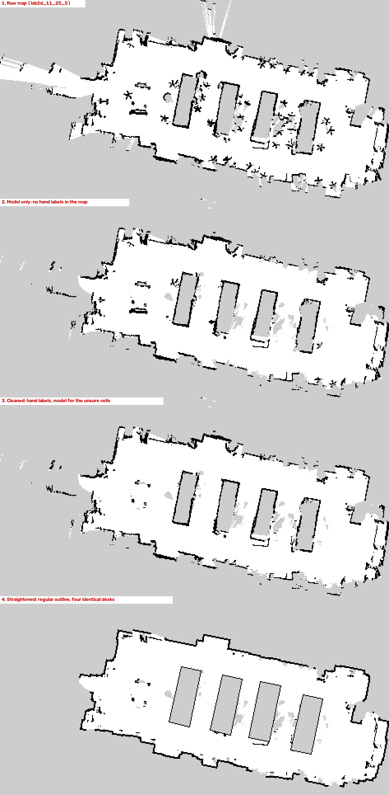
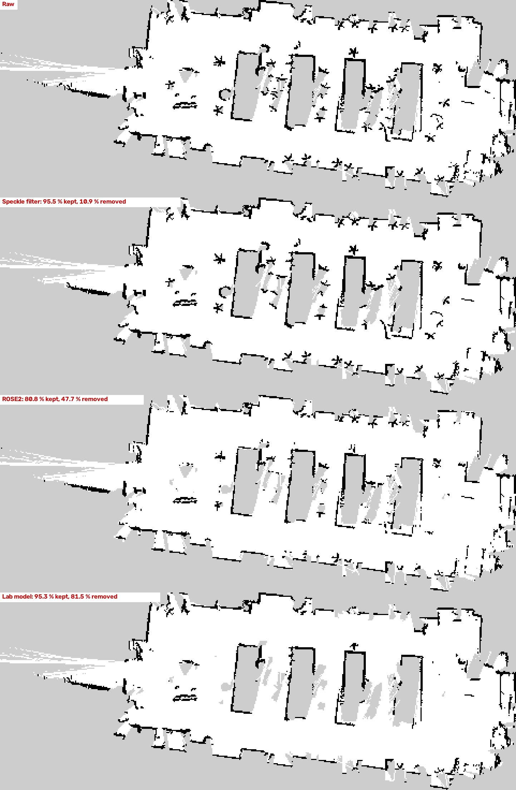

# Map cleaning: results (26 Nov 2026)

Question: can an ML model turn a raw 2D lidar occupancy map into a clean one the robot can use?

Answer: yes for the lab, when the task is framed as erasing cells and a few maps of the room are hand-labelled.
It does not yet carry over to other buildings.

Code: `ml/map_clean/`, labelling tool: `scripts/map_labeler.py`. Data, models and raw result files are in
`data/map_cleaning/` (git-ignored). Maps are Nav2 trinary maps at 0.05 m per cell.

## The maps for the robot

`maps/lab2d_11_25_5/maps_2d_cleaned/` holds three candidates on the same grid and origin as the raw map, so the
checkpoints in `maps/lab2d_11_25_5/checkpoints/` apply unchanged.

| File | What it is |
|---|---|
| `lab2d_11_25_5_model_only` | The lab model applied to the raw map, then the door-leak rule. No hand labels in the map: 95.2 % of structure kept, 74.9 % of clutter removed (162 structure cells lost, 352 clutter cells left) |
| `lab2d_11_25_5_cleaned` | Hand labels where given (4,750 of 5,741 occupied cells), the lab model for the 991 cells left unsure, floor that leaked through the door cut off |
| `lab2d_11_25_5_straightened` | The cleaned map with a regular outer wall and the four benches drawn as identical rectangles (3.45 x 1.25 m) |



Recommended for driving: `cleaned`, because nothing real is missing from it. `model_only` is what the ML produces
unaided. `straightened` is the polished version, to be used once a live run confirms it. None has been driven live yet.
The hand labels of this map set the model's threshold but were not used to train it.

## The model

- Erase only: for every occupied cell the network outputs the probability that it is movable clutter. Cells above a
  threshold are erased (to floor if floor touches them, otherwise to unknown). It cannot draw or move a wall.
- U-Net, about 11 M parameters, input 3 x 256 x 256 (free / occupied / unknown), output one erase score per cell.
- Labels per occupied cell: keep, erase, or unsure (ignored). Sources: hand labels (browser tool), hand labels
  carried to the same place in other aligned sessions, agreement between sessions, and in simulation the object each
  ray hit.
- Loss: binary cross-entropy on labelled occupied cells, a keep cell weighted 3 times an erase cell. AdamW, learning
  rate 2e-4, batch 32. Lab maps are cropped at random positions and angles.
- Lab model: 14 real lab maps from four days, 20 epochs of 300 steps, about 30 minutes on one L40S.
- General model: 81,458 simulated patches from every HouseExpo house and every KTH room (no rooms invented by code,
  205 degree lidar, simulated drift, noise, dropouts and clutter), 10 epochs, 90 minutes.
- Threshold: the highest-removal setting that keeps 95 % of structure on a separate hand-labelled validation map.

## Scoreboard

Scoring (changed on 26 Nov; the first version counted structure only on the exact cell, which is unfair to methods
that redraw walls):

- Structure kept: a cell hand-marked keep counts if the output has an occupied cell within 10 cm. Mark: >= 95 %.
- Clutter removed: a cell hand-marked erase counts if no occupied cell is left within 5 cm. Mark: >= 60 %.
- Invented walls: occupied cells with no raw wall within 10 cm. Added floor: floor where the raw map was unknown.
- All four lab maps: the same two measures as a mean over the four hand-labelled maps; for the lab-trained models each
  map is scored by a model that never saw any map of that day.

Test map `lab2d_11_25_7`: 2,913 keep, 1,386 erase, 677 unsure cells. Exact-cell figures in brackets. AMCL error is on
a drive of the mapping session itself (raw: 4.8 cm).

| Method | Structure kept | Clutter removed | Invented cells / added floor | All four lab maps: kept / removed | MIT Stata (unseen): kept / removed | AMCL error |
|---|---|---|---|---|---|---|
| Raw | 100.0 % | 0.0 % | 0 | 100 % / 0 % | 100 % / 0 % | 4.8 cm |
| Speckle filter | 96.6 % (95.5) | 10.9 % (10.9) | 0 | 96.7 % / 10.1 % | 96.8 % / 27.1 % | 4.2 cm |
| ROSE2, default settings | 96.3 % (80.8) | 27.3 % (47.7) | 0 | 96.0 % / 26.3 % | 72.2 % / 76.1 % | 5.0 cm |
| Session agreement, cautious | 100.0 % (99.9) | 20.2 % (26.5) | 0 | 100 % / 11.1 % | needs several sessions | 5.2 cm |
| Session agreement, aggressive | 91.4 % (87.0) | 66.7 % (73.4) | 0 | 94.0 % / 53.4 % | needs several sessions | 9.8 cm |
| Vote of the other sessions | 79.2 % (22.0) | 77.2 % (93.9) | 686 / 9.8 m2 | 91.7 % / 62.9 % | needs several sessions | 17.7 cm |
| Earlier model (redraws the map, simulated data) | 77.7 % (54.3) | 93.7 % (96.9) | 258 / 10.0 m2 | 74.6 % / 91.1 % | 89.8 % / 50.9 %, invents 3,685 cells and 341 m2 | 9.6 cm |
| Earlier model + guardrail | 91.6 % (77.1) | 77.8 % (84.7) | 258 / 10.0 m2 | 91.1 % / 79.9 % | needs several sessions | 10.0 cm |
| General model, simulated only | 69.9 % (63.6) | 96.5 % (96.7) | 0 | 97.1 % / 51.3 % with a lab-set threshold | 91.3 % / 52.9 % | 17.9 cm |
| Lab model | 96.4 % (95.3) | 77.7 % (81.5) | 0 | 97.3 % / 68.0 % | 92.5 % / 26.9 % | 7.6 cm |
| **General model fine-tuned on the lab** | **96.8 %** (95.2) | **79.6 %** (82.3) | 0 | **96.6 % / 73.9 %** | 96.9 % / 32.9 % | 8.3 cm |
| Lab model with ROSE2's kept cells put back | 99.5 % (98.0) | 23.7 % (41.1) | 0 | 99.8 % / 19.0 % | 97.4 % / 23.4 % | 4.5 cm |

For the lab-trained models the "all four lab maps" figure is with a whole day held out: worst case for the
fine-tuned model 94.6 % kept and 67.7 % removed, for the lab model 95.1 % and 64.2 %. MIT Stata: 14 real map pieces,
each method used with its lab settings.



- Only the two lab-trained models pass both marks, and they invent nothing. The fine-tuned general model is the best
  row: it also holds structure in the unseen building.
- Nothing carries clutter removal over: methods that keep structure in MIT Stata remove a quarter to a third of the
  clutter; ROSE2 removes 76 % there and loses 28 % of the structure.
- The earlier model keeps the main walls and benches, so its map looks cleanest; about a fifth of the hand-marked
  structure has no wall near it, it invents walls and floor, and on the robot's map the planned tour passes within the
  robot's radius of real structure in 77 cells.
- The tolerance is a choice: at 5 cm ROSE2 drops to 93.2 %, at 20 cm the earlier model with guardrail reaches 95.3 %.
  The earlier model alone fails at every tolerance and the lab model passes at every one.
- The hand labels started from session-agreement proposals, so they are not independent of the methods scored.

## Day held out (the number to quote)

Exact-cell scoring, with the threshold moved to compare models at one operating point. Four lab models. Two never see any 25 Nov map and are scored on the two hand-labelled 25 Nov maps; two never see
24 Nov. Carried-over labels are rebuilt per model, so no hand label of the held-out day is used.

| | Mean | Range over 8 tests |
|---|---|---|
| Clutter removed at exactly 95 % structure kept | 75.4 % | 64.6 to 90.2 % |
| Ranking score (AUC) | 0.93 | 0.86 to 0.97 |
| Structure kept, threshold from validation | 95.8 % | 92.2 to 99.0 % |
| Clutter removed, threshold from validation | 73.1 % | 68.0 to 81.9 % |

Safety margin on the threshold (keep target on the validation map):

| Keep target | Structure kept: mean / worst | Tests below 95 % | Clutter removed: mean / worst |
|---|---|---|---|
| 0.95 | 95.8 % / 92.2 % | 3 of 8 | 73.1 % / 68.0 % |
| 0.96 | 96.6 % / 93.6 % | 2 of 8 | 68.6 % / 63.3 % |
| 0.97 | 98.0 % / 95.8 % | 0 of 8 | 47.7 % / 0.0 % |

A margin that guarantees 95 % on every test costs a third of the clutter removal, and for one model removes nothing.
The threshold stays at the 0.95 target.

## Other buildings

Clutter removed at exactly 95 % structure kept (ranking score in brackets).

| Model | MIT Stata, 14 real map pieces | Semantic2D, 2 held-out lobbies | Lab, 4 hand-labelled maps |
|---|---|---|---|
| General, simulated only | 37.2 % (0.82) | 21.0 % (0.72) | 70.7 % (0.93) |
| Semantic2D only (9 real labelled maps) | 15.5 % (0.65) | 14.4 % (0.66) | 5.0 % on one map |
| Simulated plus Semantic2D | 30.8 % (0.77) | 19.7 % (0.70) | 68.6 % on one map |
| Simulated, fine-tuned on two hand-corrected Radish buildings | 33.8 % (0.69) | 4.9 % (0.55) | 71.7 % |
| Lab models (day held out) | 16.4 % (0.72) | 6.0 % (0.55) | 75.4 % (0.93) |

- The model trained only on simulated floor plans ranks the lab's cells as well as models trained in the lab. Its
  threshold is fragile (scores pile up near 1), so the lab-trained model is the one used for the robot.
- Adding real labelled maps from other buildings (Semantic2D; Bremen and Stanford Gates from Radish) did not improve
  any independent test. Semantic2D has little clutter: 3.8 % of its occupied cells.
- In buildings no model has seen, at most 37 % of clutter is removed. On MIT Stata the labels come from floor plans
  without furniture, so fixed furniture counts as clutter there, which the models were taught to keep.

## Localisation (AMCL replay)

The recorded scan and odometry of the 25 Nov drive (session `lab2d_11_25_7`) played into Nav2's AMCL; error against
the pose slam_toolbox recorded.

| Map | Drive relative to the map | Mean error |
|---|---|---|
| 25 Nov map 7, raw | same session | 4.8 cm |
| 25 Nov map 7, lab model | same session | 7.6 cm |
| 25 Nov map 7, cleaned exactly to the hand labels | same session | 7.9 cm |
| 24 Nov map 3, raw / hand-cleaned | next day | 15.5 / 13.6 cm |
| 24 Nov map 8, raw / hand-cleaned | next day | 12.4 / 14.3 cm |
| Robot map (25 Nov map 5), raw | another session | 18.8 cm |
| Robot map, cleaned | another session | 18.7 cm |
| Robot map, straightened | another session | 17.3 cm |

- In the mapping session itself the chairs stand where the raw map shows them and act as landmarks; a perfectly
  cleaned map scores no better than the model's. The 3 cm gap is not caused by model mistakes.
- When the drive comes from another session, most of the 12 to 19 cm is the error of lining up two sessions' maps.
  Only rows of the same map compare. There cleaning and straightening make no clear difference.
- One drive, one run per map. A drive recorded on the final map is still needed.

## Planning check

Shortest routes through the eight checkpoints and back on a grid version of the global planner: drivable = free and
at least 22 cm (the robot's half diagonal) from any occupied cell; unknown is not drivable.

| Map | Legs with a route | Tour length | Route cells within 22 cm of structure hand-marked keep |
|---|---|---|---|
| Raw | 8 of 8 | 47.6 m | 0 |
| Model only | 8 of 8 | 42.5 m | 0 |
| Cleaned | 8 of 8 | 42.3 m | 0 |
| Straightened | 8 of 8 | 42.5 m | 0 |


Removing clutter shortens the tour by 5 m. An earlier straightened version with benches drawn at 3.05 x 1.12 m let
routes pass within the robot's radius of real bench edges; the rectangles now use the largest measured extent.

## Limits

- One room. Each model trained once; differences of a point or two between models are not established.
- The robot's map is mostly decided by hand labels; the model's own performance is the day-held-out result.
- The straightened map moves walls and bench edges by up to 10 to 20 cm; 68 % of hand-kept cells have a wall within
  10 cm, 91 % within 20 cm. No tape measurement of the room exists to check it against.
- The planning check is not Nav2 itself, and nothing has been driven live on the cleaned or straightened map.
- Session agreement, used for part of the training labels, cannot tell fixed furniture from furniture that never moved.

## Reproduce

```
# label maps in the browser (http://127.0.0.1:8507)
python3 scripts/map_labeler.py
# train the lab model, then clean a map
python -m ml.map_clean.erase train --name lab --lab-val lab2d_11_25_5 --lab-test lab2d_11_25_7
python -m ml.map_clean.erase clean RAW.pgm OUT.pgm --model data/map_cleaning/models2/lab.pt --thr 0.26
python -m ml.map_clean.door_leak RAW.pgm OUT.pgm CLEANED.pgm
# straighten: benches, then the room outline
python -m ml.map_clean.straighten CLEANED.pgm DESKS.pgm --desks 4 --desk-size 3.45 1.25 --labels LABEL.png
python -m ml.map_clean.outline CLEANED.pgm DESKS.pgm STRAIGHT.pgm
# checks
python -m ml.map_clean.fold_eval
python -m ml.map_clean.plan_check --checkpoints CP.yaml --labels LABEL.png --maps "Raw=RAW.yaml" "Cleaned=CLEANED.yaml"
python3 ml/map_clean/amcl_replay.py --bag BAG.db3 --maps "raw=RAW.yaml" "cleaned=CLEANED.yaml"
```
