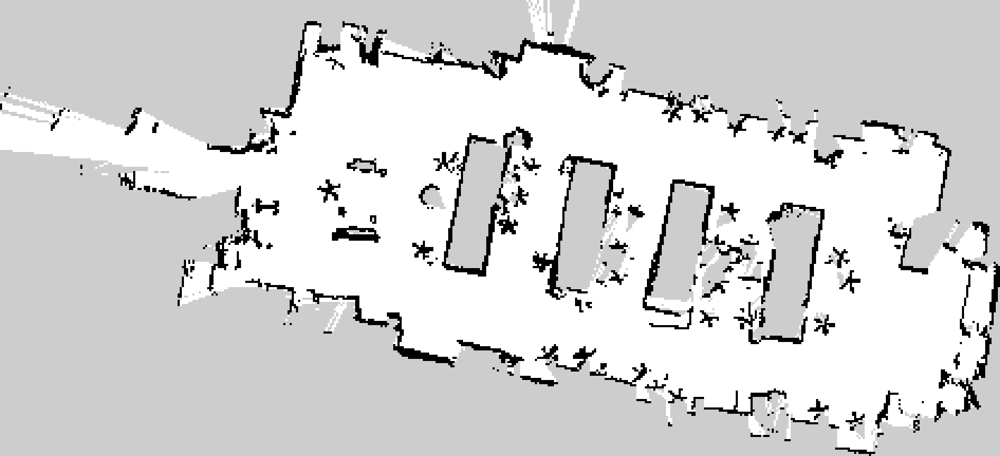
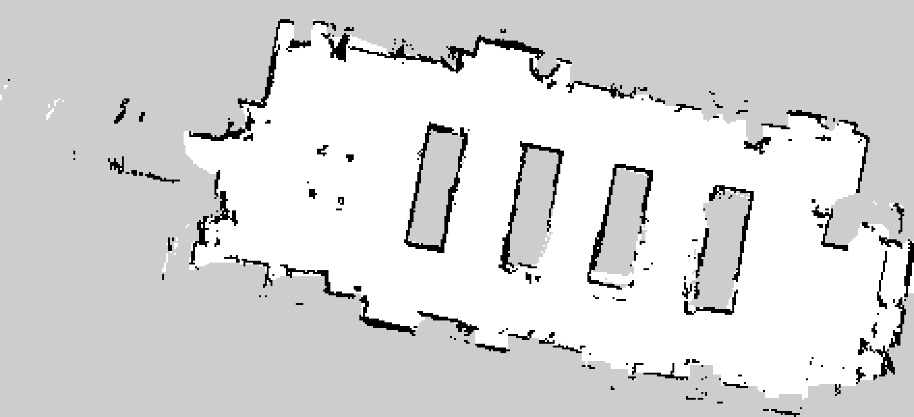

# Map cleaning: results (27 Nov 2026)

Question: can an ML model turn a raw 2D lidar occupancy map into a clean one the robot can use?

Answer: yes for the lab, with an erase-only U-Net pre-trained on simulated floor plans and fine-tuned on a few labelled
maps of the room. It does not carry over to other buildings.

Code: `ml/map_clean/`, map editor: `scripts/map_labeler.py`. Data, models and raw result files are in
`data/map_cleaning/` (git-ignored). Maps are Nav2 trinary maps at 0.05 m per cell. Slides: `slides/`.

## The maps for the robot

`maps/lab2d_11_25_5/maps_2d_cleaned/` holds the cleaned versions of the robot's map. All are on the raw map's grid and
origin, so the same 8 checkpoints apply; `maps/lab2d_11_25_5/checkpoints/` has a checkpoint file under each map's name.

| File | What it is |
|---|---|
| `lab2d_11_25_5_best_faithful` | The best map: fine-tuned erase-only U-Net + session agreement + clean-up; see below |
| `lab2d_11_25_5_model_only` | The fine-tuned erase-only U-Net alone, then the door-leak cut. The model never saw a 25 Nov map and its threshold was set on a 24 Nov map, so no hand label of this map or its day is used: 99.2 % of structure kept, 77.4 % of clutter removed (54 structure cells lost, 247 clutter cells left) |
| `lab2d_11_25_5_cleaned` | Hand labels where given (4,750 of 5,741 occupied cells), the lab-only erase-only U-Net for the 991 cells left unsure, door leak cut |




In all three, unseen patches inside the room (lidar shadows behind furniture, and notches in the wall whose opening
to the outside is narrower than the robot, 2.5 m2 in total) are turned into floor; bench interiors, the insides of
solid objects and openings wider than 35 cm stay unknown (`ml/map_clean/fill_unknown.py`). No wall is drawn across a
notch.

Which map the robot drives on is left open until the live test on 30 Nov: raw, the best map and `model_only` are
driven, `cleaned` is optional. None has been driven live yet. One object marked keep, 15 cells at about (-6.57, 4.47)
in the map frame, is erased in `model_only`; the planned leg from checkpoint 7 to 8 passes 10 cm from it.

## The best map

`maps/lab2d_11_25_5/maps_2d_cleaned/lab2d_11_25_5_best_faithful`, made by `ml/map_clean/best_map.py`.

1. **Fine-tuned erase-only U-Net and session agreement decide each occupied cell together.** Erase when the U-Net says
   erase and fewer than 85 % of the other days' maps have a wall there, or when fewer than 20 % of them have one. The
   U-Net is the mean of the two fine-tuned copies that never saw 25 Nov. With a day held out on the four hand-labelled
   maps this step keeps 98.3 % of structure (worst map 98.0 %) and removes 77.1 % of clutter (worst 69.8 %); the
   U-Net alone gives 96.6 % and 73.9 %.
2. **Hand labels overrule.** The map's own labels, then labels of the other labelled maps carried to the same place.
   They changed the decision on 359 of 5,741 cells.
3. **Cut the door leak** (9.0 m2).
4. **Use what the other 16 mapping sessions saw where this one saw nothing,** inside the room only: 1.97 m2 of floor
   that most sessions show, and 92 wall cells that at least half the sessions have at exactly that cell and that no
   hand label calls clutter. Mostly bench edges hidden behind chairs on that day.
5. **Last,** the remaining 1.0 m2 of unseen patches inside the room become floor. Nothing is drawn that no mapping
   session saw.

| Map | Structure within 10 / 20 cm | Clutter removed | Invented cells | Tour | Route cells too close to real structure | AMCL, drive from another session |
|---|---|---|---|---|---|---|
| Raw | 100 % / 100 % | 0 % | 0 | 47.6 m | 0 | 18.8 cm |
| Fine-tuned erase-only U-Net alone | 99.2 % / 99.7 % | 77.4 % | 0 | 42.3 m | 13 | 18.5 cm |
| Best map (uses this map's hand labels) | 100 % / 100 % | 94.8 % | 2 | 42.3 m | 0 | 19.8 cm |
| Best map, no hand labels of the test map (mean of 4 maps) | 98.7 % / 99.6 % | 72.8 % | 13 | | | |

The first three rows are the robot's map. The best map there uses its own hand labels, so its score is high by
construction. The last row is the fair test (`build(..., blind=True)`): for each of the four labelled maps the best
map is built without that map's labels or any label from its day. It keeps more structure than the U-Net alone
(98.7 % against 96.6 %; worst map 98.1 %) and removes about as much clutter (72.8 % against 73.9 %; worst map 62.2 %).
AMCL differences of a centimetre are within what one replay can show.

The best map depends on which hand labels exist, because it carries them over from other days. With the labels as
they are since 26 Nov (the 25 Nov map 7 label revised, a 23 Nov map labelled) the last row is 98.9 % and 69.0 %.

## The models

One U-Net, about 11 M parameters, input 3 x 256 x 256 (free / occupied / unknown), with two alternative output heads:

- **Erase-only U-Net:** one erase score per occupied cell. Cells above a threshold are erased (to floor if floor
  touches them, otherwise to unknown). It cannot draw or move a wall.
- **Generative U-Net:** three outputs per cell, so it redraws the whole map and may change any cell. Its training
  target is the input with its clutter-labelled cells removed. No threshold.

Both are trained the same way, from scratch:

1. **Pre-training:** 81,458 simulated patches from every HouseExpo house and every KTH room (no rooms invented by
   code, 205 degree lidar, simulated drift, noise, dropouts and clutter). Labels: what each simulated ray hit. 10
   epochs, learning rate 2e-4, batch 32, about 90 minutes on one L40S.
2. **Fine-tuning:** real maps of the lab from other days: 8 for each day-held-out model, 14 for the robot's own
   model. One is labelled by hand in the map editor; its labels are carried to the same places in the others, and
   agreement between sessions labels the rest. 10 epochs of 300 steps, learning rate 5e-5, about 10 minutes.

- Loss: cross-entropy; for the erase-only U-Net on labelled occupied cells only, a keep cell weighted 3 times an
  erase cell. Lab maps are cropped at random positions and angles.
- Threshold: the highest-removal setting that keeps 95 % of structure on a separate hand-labelled validation map.
- Lab-only erase-only U-Net: the fine-tuning data only, 20 epochs of 300 steps, about 30 minutes.

## Scoreboard: every method tried

- Structure kept: a cell hand-marked keep counts if the output has an occupied cell within 10 cm. Mark: >= 95 %.
- Clutter removed: a cell hand-marked erase counts if no occupied cell is left within 5 cm. Mark: >= 60 %.
- Invented walls: occupied cells with no raw wall within 10 cm.
- Lab, 4 maps: mean over the four hand-labelled maps. For anything trained on lab maps, each map is scored by a model
  that never saw any map of that day (4 models, 8 tests). This is the column to compare.

Test map `lab2d_11_25_7`: 2,913 keep, 1,386 erase, 677 unsure cells. AMCL error is on a drive of the mapping session
itself. MIT Stata: the 14 map pieces ROSE2 was run on.

| Method | Lab, 4 maps: kept / removed (worst test) | Invented cells, 4-map mean | Test map 25_7: kept / removed | MIT Stata, 14 pieces: kept / removed | AMCL error, same-session drive |
|---|---|---|---|---|---|
| **Reference** | | | | | |
| Raw map | 100 % / 0 % | 0 | 100 % / 0 % | 100 % / 0 % | 4.8 cm |
| **Baselines without ML** | | | | | |
| Speckle filter | 96.7 % / 10.1 % | 0 | 96.6 % / 10.9 % | 96.8 % / 27.1 % | 4.2 cm |
| ROSE2, filter 0.10 | 99.3 % / 5.6 % | 0 | 99.0 % / 5.5 % | 88.0 % / 38.5 % | 4.9 cm |
| ROSE2, filter 0.14 | 98.5 % / 13.4 % | 0 | 98.4 % / 14.1 % | 80.2 % / 60.3 % | 4.9 cm |
| ROSE2, filter 0.18 (default) | 96.0 % / 26.3 % | 0 | 96.3 % / 27.3 % | 72.2 % / 76.1 % | 5.0 cm |
| ROSE2, filter 0.22 | 92.1 % / 42.7 % | 0 | 91.7 % / 43.9 % | 65.3 % / 85.7 % | 5.5 cm |
| ROSE2, filter 0.26 | 86.5 % / 59.0 % | 0 | 86.2 % / 58.3 % | 59.1 % / 91.1 % | 5.8 cm |
| ROSE2, filter 0.30 | 79.4 % / 72.7 % | 0 | 80.4 % / 69.7 % | 53.7 % / 95.1 % | 7.0 cm |
| Session agreement, cautious | 100 % / 11.1 % | 0 | 100 % / 20.2 % | needs repeat maps | 5.2 cm |
| Session agreement, aggressive | 94.0 % / 53.4 % | 0 | 91.4 % / 66.7 % | needs repeat maps | 9.8 cm |
| Session vote (new map from all sessions) | 91.7 % / 62.9 % | 421 | 79.2 % / 77.2 % | needs repeat maps | 17.7 cm |
| **Erase-only U-Net, no lab maps in training** (lab column: threshold set on a labelled lab map of another day; other columns: the model's own threshold) | | | | | |
| Erase-only U-Net trained on simulated maps (`general_sim`) | 97.1 % / 51.3 % (94.8 / 0.0) | 0 | 69.9 % / 96.5 % | 91.3 % / 52.9 % | 17.9 cm |
| Erase-only U-Net trained on Semantic2D real maps (`s2d_real`) | 96.8 % / 6.1 % (94.4 / 3.5) | 0 | 93.9 % / 7.4 % | 97.8 % / 9.9 % | 4.6 cm |
| Erase-only U-Net trained on simulated + Semantic2D (`s2d_simreal`) | 96.0 % / 66.3 % (88.2 / 50.4) | 0 | 66.9 % / 95.5 % | 96.6 % / 29.0 % | 9.6 cm |
| Erase-only U-Net trained on simulated + Semantic2D + Radish (`joint_real`) | 96.6 % / 62.6 % (94.3 / 53.6) | 0 | 71.0 % / 97.5 % | 95.7 % / 34.9 % | 10.2 cm, lost at the end |
| Erase-only U-Net pre-trained on simulation, fine-tuned on Radish (`radish_ft`) | 96.0 % / 52.7 % (89.9 / 0.0) | 0 | 95.5 % / 78.2 % | 98.1 % / 23.7 % | 7.4 cm |
| **Erase-only U-Net with lab maps of other days in training** (day held out) | | | | | |
| Erase-only U-Net trained on lab maps only (`fold_*`; robot's model `lab`) | 97.3 % / 68.0 % (95.1 / 64.2) | 0 | 96.4 % / 77.7 % | 92.5 % / 26.9 % | 7.6 cm |
| Erase-only U-Net trained on lab maps only, seed 2 (`fold_*_s1`) | 97.4 % / 65.4 % (95.7 / 56.6) | 0 | 97.9 % / 59.0 % | 95.3 % / 21.1 % | 6.4 cm |
| **Erase-only U-Net pre-trained on simulation, fine-tuned on lab maps** (`ftfold_*`; robot's model `general_ft`) | **96.6 % / 73.9 %** (94.6 / 67.7) | 0 | 96.8 % / 79.6 % | 96.9 % / 32.9 % | 8.3 cm |
| Erase-only U-Net fine-tuned on lab maps, seed 2 (`ftfold_*_s1`) | 97.0 % / 71.0 % (94.9 / 65.7) | 0 | 97.0 % / 71.7 % | 98.1 % / 24.1 % | 6.6 cm |
| Erase-only U-Net fine-tuned on lab maps, seed 3 (`ftfold_*_s2`) | 96.5 % / 74.5 % (94.2 / 69.5) | 0 | 96.5 % / 72.7 % | 97.6 % / 27.8 % | 7.2 cm |
| Erase-only U-Net fine-tuned on lab maps, keep target 96 % | 97.5 % / 66.4 % (95.8 / 56.0) | 0 | 97.6 % / 68.2 % | 98.3 % / 22.3 % | 5.9 cm |
| Erase-only U-Net fine-tuned on lab maps, keep target 97 % | 98.3 % / 57.0 % (96.7 / 39.7) | 0 | 97.9 % / 62.0 % | 98.9 % / 16.9 % | 6.2 cm |
| Erase-only U-Net pre-trained on simulation + Semantic2D, fine-tuned on lab maps (`s2dft_*`) | 96.8 % / 72.8 % (94.1 / 64.9) | 0 | 96.4 % / 69.8 % | 97.4 % / 25.8 % | 6.7 cm |
| **Generative U-Net** (same data; outputs the whole map; no threshold) | | | | | |
| Generative U-Net trained on simulated maps (`redraw_sim`) | 87.6 % / 85.8 % (83.0 / 80.2) | 0 | 89.6 % / 90.0 % | 97.4 % / 27.3 % | 7.8 cm |
| Generative U-Net pre-trained on simulation, fine-tuned on lab maps (`redrawft_*`) | 97.7 % / 69.2 % (95.5 / 57.7) | 0 | 97.9 % / 73.8 % | 98.6 % / 18.1 % | 8.4 cm |
| **Combinations** | | | | | |
| Erase-only U-Net (lab only) + ROSE2 kept cells | 99.8 % / 19.0 % | 0 | 99.5 % / 23.7 % | 97.4 % / 23.4 % | 4.5 cm |
| Fine-tuned erase-only U-Net + session agreement, before clean-up | 98.3 % / 77.1 % (98.0 / 69.8) | 0 | 97.7 % / 81.0 % | needs repeat maps | 8.7 cm |
| Best map: fine-tuned erase-only U-Net + session agreement, then clean-up | 98.7 % / 72.8 % (98.1 / 62.2) | 13 | 99.3 % / 71.6 % | needs repeat maps | 7.4 cm |

- Both marks are passed on average by 12 rows: every erase-only U-Net with lab maps in training except the 97 % keep
  target, the generative U-Net after fine-tuning, the two no-lab models that mix real maps with simulated ones, and
  the two combinations that add session agreement. No method without ML passes.
- The best single model is the erase-only U-Net pre-trained on simulation and fine-tuned on lab maps: 96.6 % / 73.9 %,
  and 96.5 to 97.0 % / 71.0 to 74.5 % over three seeds.
- Before fine-tuning each U-Net fails one mark: the generative one erases too much (87.6 % kept), the erase-only one
  too little (51.3 % removed). After fine-tuning on lab maps both pass.
- Models without lab maps need a threshold from somewhere. With one set on a lab map of another day, the
  simulated-only erase-only U-Net removes nothing on its worst tests, because its scores pile up near 1. Mixing real
  maps into training steadies that (62.6 % and 66.3 % against 51.3 %). It does not help in other buildings.
- A stricter keep target buys structure at a steep price in clutter: 96 % costs 7.5 points of removal, 97 % costs 17.
- In MIT Stata nothing passes both marks. Among rows that keep 95 % of structure the most clutter removed is 34.9 %.
  ROSE2 only trades one mark for the other there. The labels come from floor plans without furniture, so fixed
  furniture counts as clutter.
- Localisation: every erase-only U-Net with lab maps stays between 5.9 and 8.3 cm on the same-session drive (raw:
  4.8 cm; a map cleaned exactly to the hand labels: 7.9 cm, because the chairs stood as mapped and acted as landmarks).
- The generative U-Net invents nothing in the lab. Across the 14 MIT Stata pieces the four fine-tuned models invent 0, 0, 4
  and 0 wall cells (an earlier version of this file said "about 100", which was wrong).
- Basis of the last three columns for lab-trained models: models that never saw 25 Nov, except the two rows that name
  the robot's models (`lab`, `general_ft`), which were scored on 26 Nov with those models; they trained on maps of the
  test day, at thresholds 0.26 and 0.21. On the stricter basis those two score 97.7 % / 64.9 % and 97.0 % / 73.2 % on
  the test map, and 94.6 % / 25.7 % and 97.7 % / 27.6 % in MIT Stata.
- The same clean-up (door leak cut, unseen patches filled) applied to every method changes neither mark for any of
  them, because it only touches floor and unknown cells.
- The tolerance is a choice: at 5 cm ROSE2 drops to 93.2 %.
- The hand labels started from session-agreement proposals, so they are not independent of the methods scored.

## Standard metrics: precision, recall, F1, accuracy

The two marks are the recall of each class. With clutter as the positive class (TP clutter erased, FN clutter left,
TN structure kept, FP structure erased):

| Number | Formula | In our terms |
|---|---|---|
| Clutter removed | TP / (TP + FN) | Recall of clutter |
| Structure kept | TN / (TN + FP) | Recall of structure (specificity) |
| Precision | TP / (TP + FP) | Share of erased cells that were clutter |
| F1 | 2 P R / (P + R) | Low if precision or clutter removed is low |
| Accuracy | (TP + TN) / all | About 0.7 x structure kept + 0.3 x clutter removed in the lab |

The tables below count on the exact cell, with no distance tolerance, on labelled cells only. So "recall" here is
not the scoreboard's "clutter removed" (which requires nothing left within 5 cm) and "structure recall" is not its
"structure kept" (which accepts a wall within 10 cm).

Lab, mean over the test maps of a held-out day (same models and thresholds as the scoreboard):

| Method | Precision | Recall (clutter) | F1 | Accuracy | Recall (structure) |
|---|---|---|---|---|---|
| Raw map | undefined | 0 % | 0 % | 70.2 % | 100 % |
| Speckle filter | 49.1 % | 10.1 % | 16.6 % | 70.1 % | 95.6 % |
| ROSE2, filter 0.18 (default) | 50.5 % | 48.5 % | 49.2 % | 70.3 % | 79.8 % |
| Session agreement, aggressive | 79.1 % | 62.8 % | 68.4 % | 82.3 % | 90.7 % |
| Generative U-Net trained on simulated maps | 70.4 % | 87.1 % | 77.9 % | 85.3 % | 84.4 % |
| Generative U-Net fine-tuned on lab maps | 90.3 % | 74.6 % | 81.6 % | 90.0 % | 96.7 % |
| Erase-only U-Net trained on simulated maps | 84.9 % | 54.6 % | 58.7 % | 83.7 % | 95.8 % |
| Erase-only U-Net trained on lab maps only | 88.0 % | 73.1 % | 79.7 % | 88.9 % | 95.8 % |
| Erase-only U-Net fine-tuned on lab maps | 87.6 % | 78.4 % | 82.6 % | 90.1 % | 95.3 % |
| Best map: fine-tuned erase-only U-Net + session agreement, then clean-up | 88.8 % | 80.6 % | 84.4 % | 91.2 % | 95.7 % |

MIT Stata, pooled over the 14 pieces; 15.5 % of the labelled cells are clutter. The two erase-only U-Nets with lab
maps are the robot's models at thresholds 0.26 and 0.21, the fine-tuned generative U-Net is the mean of the four
day-held-out models, the simulated-only erase-only U-Net uses its own threshold:

| Method | Structure kept / clutter removed (scoreboard rules) | Precision | Recall (clutter) | F1 | Accuracy |
|---|---|---|---|---|---|
| Raw map | 100 % / 0 % | undefined | 0 % | 0 % | 84.5 % |
| Speckle filter | 96.8 % / 27.1 % | 56.0 % | 27.1 % | 36.5 % | 85.4 % |
| ROSE2, filter 0.18 (default) | 72.2 % / 76.1 % | 26.9 % | 85.4 % | 40.9 % | 61.7 % |
| Generative U-Net trained on simulated maps | 97.4 % / 27.3 % | 61.7 % | 28.9 % | 39.4 % | 86.2 % |
| Generative U-Net fine-tuned on lab maps | 98.6 % / 18.1 % | 68.0 % | 20.2 % | 30.7 % | 85.9 % |
| Erase-only U-Net trained on simulated maps | 91.3 % / 52.9 % | 46.2 % | 54.9 % | 50.2 % | 83.1 % |
| Erase-only U-Net trained on lab maps only | 92.5 % / 26.9 % | 35.5 % | 30.0 % | 32.5 % | 80.7 % |
| Erase-only U-Net fine-tuned on lab maps | 96.9 % / 32.9 % | 60.8 % | 34.8 % | 44.3 % | 86.4 % |

- The ranking in the lab is the same as with the two marks: the best map and the fine-tuned erase-only U-Net lead on F1
  and accuracy.
- Accuracy is a weak measure here. Erasing nothing scores 70.2 % in the lab and 84.5 % in MIT Stata; the speckle
  filter and ROSE2 score the same as erasing nothing in the lab.
- Precision adds something the marks do not show: of the cells the fine-tuned erase-only U-Net erases in the lab,
  87.6 % are clutter; for the speckle filter and ROSE2 it is about half.
- From the lab to MIT Stata the fine-tuned erase-only U-Net falls from F1 82.6 % to 44.3 %. The MIT Stata labels
  count fixed furniture as clutter, which lowers precision and F1 there for every method.
- Scripts: `data/map_cleaning/folds/standard_metrics.py` and `standard_metrics_stata.py` (not in the repo).

## Day held out: the lab-only erase-only U-Net in detail

Exact-cell scoring, with the threshold moved to compare models at one operating point. Four models. Two never see any
25 Nov map and are scored on the two hand-labelled 25 Nov maps; two never see 24 Nov. Carried-over labels are rebuilt
per model, so no hand label of the held-out day is used.

| | Mean | Range over 8 tests |
|---|---|---|
| Clutter removed at exactly 95 % structure kept | 75.4 % | 64.6 to 90.2 % |
| Ranking score (AUC) | 0.93 | 0.86 to 0.97 |
| Structure kept, threshold from validation | 95.8 % | 92.2 to 99.0 % |
| Clutter removed, threshold from validation | 73.1 % | 68.0 to 81.9 % |

Safety margin on the threshold (keep target on the validation map):

| Keep target | Structure kept: mean / worst | Tests below 95 % | Clutter removed: mean / worst |
|---|---|---|---|
| 0.95 | 95.8 % / 92.2 % | 3 of 8 | 73.1 % / 68.0 % |
| 0.96 | 96.6 % / 93.6 % | 2 of 8 | 68.6 % / 63.3 % |
| 0.97 | 98.0 % / 95.8 % | 0 of 8 | 47.7 % / 0.0 % |

A margin that guarantees 95 % on every test costs a third of the clutter removal, and for one model removes nothing.
The threshold stays at the 0.95 target.

## Other buildings

Clutter removed when the threshold is placed to keep exactly 95 % of structure, exact-cell scoring (ranking score in
brackets). One basis for all rows: the 22 MIT Stata pieces with at least 1,500 labelled cells.

| Erase-only U-Net trained on | MIT Stata, 22 pieces | Semantic2D, 2 held-out Temple lobbies | Lab, 4 hand-labelled maps |
|---|---|---|---|
| Simulated only | 37.0 % (0.82) | 21.0 % (0.72) | 70.7 % (0.93) |
| Semantic2D only (9 real labelled maps) | 13.4 % (0.64) | 14.4 % (0.66) | 9.2 % (0.74) |
| Simulated + Semantic2D | 29.9 % (0.78) | 19.7 % (0.70) | 70.4 % (0.93) |
| Simulated + Semantic2D + Radish, trained together | 33.5 % (0.81) | 19.6 % (0.72) | 67.9 % (0.93) |
| Simulated, fine-tuned on Radish (2 buildings) | 33.7 % (0.70) | 4.9 % (0.55) | 71.7 % (0.92) |
| Simulated, fine-tuned on lab maps | 36.2 % (0.75) | 4.3 % (0.48) | 80.0 % (0.94), day held out |
| Lab maps only | 16.6 % (0.71) | 6.0 % (0.55) | 75.4 % (0.93), day held out |

- The model trained only on simulated floor plans ranks the lab's cells as well as models trained in the lab. Its
  threshold is fragile (scores pile up near 1), so the lab-trained model is the one used for the robot.
- Real labelled maps from other buildings did not improve any test in a building the model had not seen, whether used
  alone, added after the simulated stage or mixed into it (9 Semantic2D maps and Bremen and Stanford Gates from
  Radish, 30 % of each batch). Semantic2D has little clutter: 3.8 % of its occupied cells.
- Fine-tuning on one place costs the others: after the lab stage the Temple lobbies fall to chance.
- In buildings no model has seen, at most 37 % of clutter is removed.

## Localisation (AMCL replay)

The recorded scan and odometry of the 25 Nov drive (session `lab2d_11_25_7`) played into Nav2's AMCL; error against
the pose slam_toolbox recorded.

| Map | Drive relative to the map | Mean error |
|---|---|---|
| 25 Nov map 7, raw | same session | 4.8 cm |
| 25 Nov map 7, erase-only U-Net (lab only) | same session | 7.6 cm |
| 25 Nov map 7, cleaned exactly to the hand labels | same session | 7.9 cm |
| 24 Nov map 3, raw / hand-cleaned | next day | 15.5 / 13.6 cm |
| 24 Nov map 8, raw / hand-cleaned | next day | 12.4 / 14.3 cm |
| Robot map (25 Nov map 5), raw | another session | 18.8 cm |
| Robot map, cleaned | another session | 18.7 cm |
| Robot map, fine-tuned erase-only U-Net alone | another session | 18.5 cm |
| Robot map, best map | another session | 19.8 cm |

- In the mapping session itself the chairs stand where the raw map shows them and act as landmarks; a perfectly
  cleaned map scores no better than the model's. The 3 cm gap is not caused by model mistakes.
- When the drive comes from another session, most of the 12 to 20 cm is the error of lining up two sessions' maps.
  Only rows of the same map compare. There cleaning makes no clear difference.
- One drive, one run per map. A drive recorded on the final map is still needed.

## Planning check

Shortest routes through the eight checkpoints and back on a grid version of the global planner: drivable = free and
at least 22 cm (the robot's half diagonal) from any occupied cell; unknown is not drivable.

| Map | Legs with a route | Tour length | Route cells within 22 cm of structure hand-marked keep |
|---|---|---|---|
| Raw | 8 of 8 | 47.6 m | 0 |
| Fine-tuned erase-only U-Net alone | 8 of 8 | 42.3 m | 13 (one erased object on the leg from checkpoint 7 to 8) |
| Cleaned | 8 of 8 | 42.3 m | 0 |
| Best map | | 42.3 m | 0 |

Removing clutter shortens the tour by 5 m.

## Repeat runs

Day held out, scoreboard scoring; each row is four models on the two hand-labelled maps of the day they never saw.

| Model | Structure kept: mean (worst test) | Clutter removed: mean (worst test) | Clutter removed at exactly 95 % kept: mean (range) |
|---|---|---|---|
| Erase-only U-Net fine-tuned on lab maps, seed 1 | 96.6 % (94.6 %) | 73.9 % (67.7 %) | 80.0 % (66.0 to 92.4 %) |
| Erase-only U-Net fine-tuned on lab maps, seed 2 | 97.0 % (94.9 %) | 71.0 % (65.7 %) | 80.3 % (65.8 to 94.0 %) |
| Erase-only U-Net fine-tuned on lab maps, seed 3 | 96.5 % (94.2 %) | 74.5 % (69.5 %) | 78.1 % (68.3 to 92.5 %) |
| Pre-trained on simulation + Semantic2D, fine-tuned on lab maps | 96.8 % (94.1 %) | 72.8 % (64.9 %) | 78.0 % (67.6 to 90.7 %) |
| Erase-only U-Net trained on lab maps only, seed 1 | 97.3 % (95.1 %) | 68.0 % (64.2 %) | 75.4 % (64.6 to 90.2 %) |
| Erase-only U-Net trained on lab maps only, seed 2 | 97.4 % (95.7 %) | 65.4 % (56.6 %) | 75.4 % (65.5 to 87.8 %) |

- The lab result is not luck of one run: over three seeds the fine-tuned erase-only U-Net keeps 96.7 % and removes
  73.1 % on average, and seeds differ by 3.5 points of clutter removal.
- Starting the fine-tune from the model that also saw Semantic2D lands inside that spread.
- Pre-training on simulation helps: the two lab-only seeds remove 65.4 and 68.0 %, the three fine-tuned seeds 71.0 to
  74.5 %.

## Erase-only against generative

Same network body, same simulated patches, same lab maps and labels, same schedule; only the output head differs.

| Model | Structure kept: mean (worst test) | Clutter removed: mean (worst test) | Invented wall cells |
|---|---|---|---|
| Erase-only U-Net fine-tuned on lab maps, three seeds | 96.7 % (94.2 %) | 73.1 % (65.7 %) | 0 |
| Generative U-Net fine-tuned on lab maps, one seed | 97.7 % (95.5 %) | 69.2 % (57.7 %) | 0 |
| Erase-only U-Net, simulated only (lab-set threshold) | 97.1 % (94.8 %) | 51.3 % (0.0 %) | 0 |
| Generative U-Net, simulated only | 87.6 % (83.0 %) | 85.8 % (80.2 %) | 0 |

Given these targets the generative U-Net only erases in the lab, and after fine-tuning it passes both marks on
average. The erase-only U-Net stays the choice: about 4 points more clutter removed (close to the seed-to-seed
spread; the generative U-Net was trained once), a better worst case, no invented wall by construction, and a
threshold that sets the trade-off.

Scoring scripts and raw figures are in `data/map_cleaning/folds/`, which is not in the repo: `score_evening*.py`,
`score_all_methods.py`, `fill_gaps.py`, `cleanup_all.py` and their `.json` outputs; the AMCL replays of 27 Nov are in
`data/map_cleaning/amcl_fill/`.

The hand label of `lab2d_11_25_7` was revised on 26 Nov at 18:13 (341 unsure cells decided). Every figure in this
file uses the earlier label (`labels/archive/lab2d_11_25_7_label_original_20261125.png`); with the revised one the
day-held-out figures move by at most 0.6 points. The best map is more sensitive; see "The best map".

## Next step

After the robot test: fine-tune on a few hand-labelled maps of a second building and test there, for the erase-only and
the generative U-Net. In the lab a handful of labelled maps of the room is what took the model from failing to
passing; whether the same works in a new place is untested. It needs several mapping sessions of a second place, a
few of them labelled by hand, with a day held out.

## Limits

- One room. The fine-tuned erase-only U-Net was trained three times (3.5 points of spread in clutter removal), the
  lab-only one twice, the others once; differences of a few points between models are not established.
- The robot's best map is partly decided by hand labels; the model's own performance is the day-held-out result.
- The planning check is not Nav2 itself, and nothing has been driven live on a cleaned map.
- Session agreement, used for part of the training labels, cannot tell fixed furniture from furniture that never moved.
- Four hand-labelled maps, labelled by one person, starting from session-agreement proposals.
- Hand labelling is needed twice: the scores rest on those four maps, and fine-tuning needs one hand-labelled map
  of each new room.

## Live demo in the map editor

`scripts/map_labeler.py` has a second toolbar. A method button marks the whole map keep / erase; the marks can be
corrected by hand; the clean-up buttons and "Show result" give the map those marks produce, scored against the saved
hand labels; "Export map" writes it to `data/map_cleaning/exports/`.

1. Without ML: raw, speckle filter, session agreement (cautious / aggressive), the vote of the other sessions (a new
   map, shown in the result view), ROSE2 (loaded from a file made beforehand in `data/map_cleaning/rose2/`, since
   ROSE2 runs in its own container).
2. With ML: erase-only U-Net fine-tuned on lab maps, erase-only U-Net trained on lab maps only, erase-only U-Net
   trained on simulated maps only. Computed when the button is pressed; needs PyTorch and the model files in
   `data/map_cleaning/models2/`.
3. Everything combined: the best map (`best_map.py`), shown in the result view.
4. Clean-up: cut door leak, fill unseen patches.

Choose a place, then a map. A place is one building; its maps are sessions or drives of that building. "Our lab"
comes first; each folder `data/map_cleaning/unseen/<id>/` with `maps/` (and `labels/`, `title.txt`) is one more place.
On those the speckle filter and the models run; session agreement, the vote and the best map need other sessions of
the same room and do not appear. Scores show only where a `<name>_label.png` exists.

A 57 s recording of the demo sequence is in `slides/video/map_demo.mp4`.

## Reproduce

```
# map editor (http://127.0.0.1:8507): hand labels, and buttons that run each method and the clean-up steps live
python3 scripts/map_labeler.py --desk-size 3.45 1.25
# train the lab-only erase-only U-Net, then clean a map
python -m ml.map_clean.erase train --name lab --lab-val lab2d_11_25_5 --lab-test lab2d_11_25_7
python -m ml.map_clean.erase clean RAW.pgm OUT.pgm --model data/map_cleaning/models2/lab.pt --thr 0.26
python -m ml.map_clean.door_leak RAW.pgm OUT.pgm CLEANED.pgm
# the best map of one session
python -m ml.map_clean.best_map lab2d_11_25_5 --out data/map_cleaning/best
# checks
python -m ml.map_clean.fold_eval
python -m ml.map_clean.plan_check --checkpoints CP.yaml --labels LABEL.png --maps "Raw=RAW.yaml" "Cleaned=CLEANED.yaml"
python3 ml/map_clean/amcl_replay.py --bag BAG.db3 --maps "raw=RAW.yaml" "cleaned=CLEANED.yaml"
```
