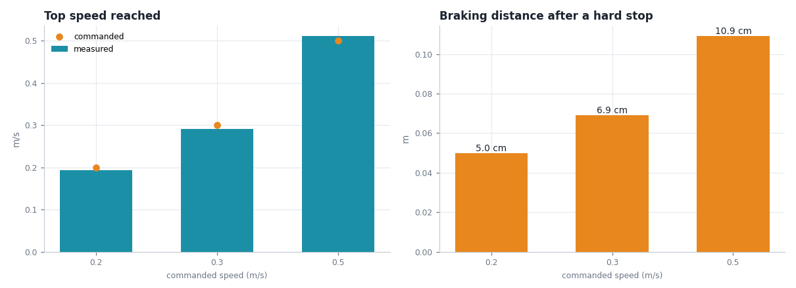
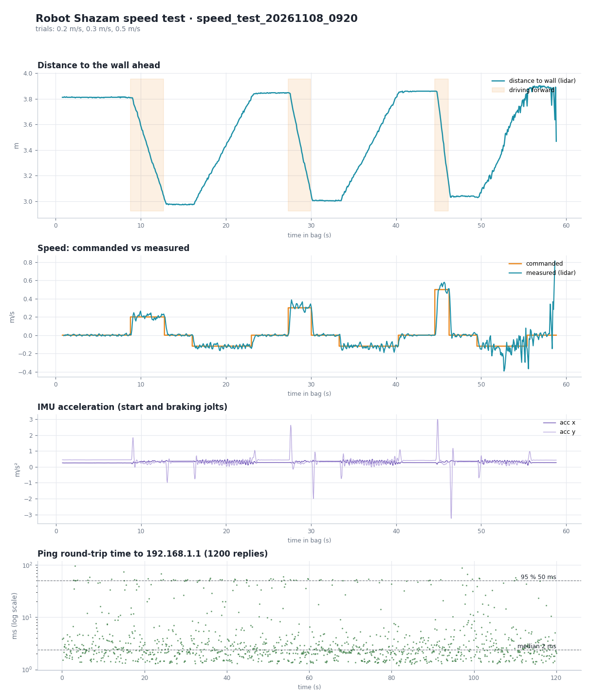
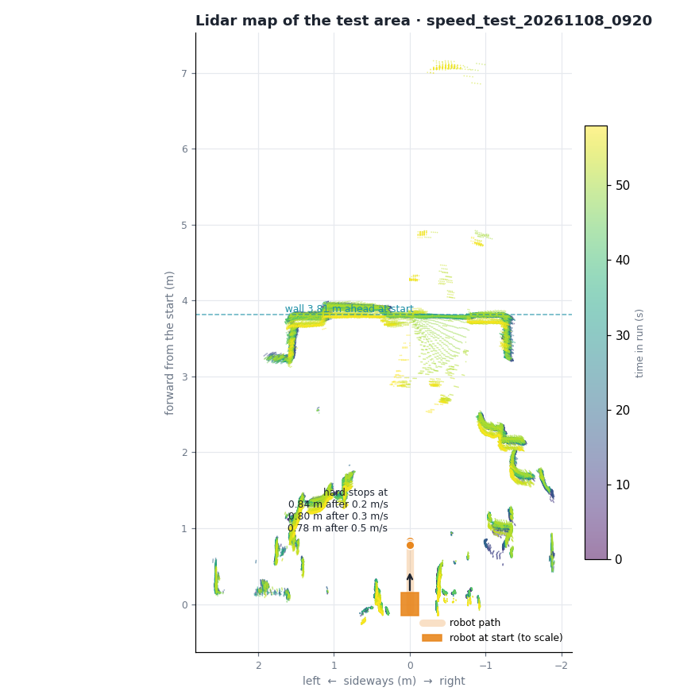

# Speed and hard-stop test, Nov 8 2026 (Robot Shazam / mecanum JetAuto)

Straight-line runs at **0.2, 0.3 and 0.5 m/s**, each about 0.8 m long and ended by a
**hard stop** (command jumps straight to zero, no ramp). A **2-minute ping** ran alongside.
Everything below comes from the rosbag in [`bag/`](bag); the numbers are reproducible with the
scripts in [`code/`](code).

| | |
|---|---|
| Date | Nov 8 2026, 09:20:56–09:21:55 (bag: 58.8 s, 6 828 messages) |
| Battery | 11.50–11.59 V |
| Surface | indoor laminate floor, robot facing a flat wall 3.81 m ahead |
| Path clear | 3.79 m inside the robot's lane (±0.23 m) at the start |

## Results

| Commanded | Measured (steady) | Peak | First motion (IMU) | Half speed reached | Braking distance | Time to standstill |
|---|---|---|---|---|---|---|
| 0.2 m/s | **0.194 m/s** (97 %) | 0.26 m/s | 0.16 s | 0.24 s | **5.0 cm** | 0.22 s |
| 0.3 m/s | **0.291 m/s** (97 %) | 0.39 m/s | 0.15 s | 0.20 s | **6.9 cm** | 0.18 s |
| 0.5 m/s | **0.511 m/s** (102 %) | 0.58 m/s | 0.16 s | 0.26 s | **10.9 cm** | 0.19 s |

Stops: the IMU sees braking start **0.15–0.17 s** after the stop command, and speed is halved
after **0.21–0.22 s**. Peak braking deceleration on the IMU is 1.3 / 2.2 / 3.4 m/s².
Full table (accelerations, delays from lidar and IMU, travel): [`analysis/trials.csv`](analysis/trials.csv).

### What this means for the stack (`config/params.yaml`, `docs/HW_MEASUREMENTS.md`)

- **`t_act`**: half of a commanded speed change arrives after 0.20–0.26 s for starts and
  0.21–0.22 s for stops. This is a little faster than the 0.30 s from the Nov 3 bag, so 0.30 s
  stays a safe (conservative) value.
- **`a_brake`**: stopping distance including the command delay corresponds to an *effective*
  deceleration of 0.38 / 0.61 / 1.2 m/s² at 0.2 / 0.3 / 0.5 m/s. These are the conservative
  numbers to use, since they include the time before the wheels react.
- **`v_max`**: the robot reached 0.51 m/s for a 0.5 m/s command. Higher speeds were not tested.
- **Speed overshoot**: speed briefly overshoots by 15–30 % (0.58 m/s peak at 0.5 m/s) before settling.

## Network (robot → Wi-Fi router, `ping -c 1200 -i 0.1 192.168.1.1`)

| Sent | Lost | Median | 95 % | 99 % | Max | Over 100 ms |
|---|---|---|---|---|---|---|
| 1200 | **0 (0 %)** | 2.4 ms | 50.4 ms | 55.2 ms | 95.1 ms | 0 |

This measures the robot's Wi-Fi link to the router, not to a specific laptop. Raw replies:
[`ping.txt`](ping.txt), per-packet times: [`analysis/ping_rtt.csv`](analysis/ping_rtt.csv).

## Timeline

Distance to the wall from the lidar, commanded vs measured speed, IMU acceleration (the
spikes are the start and braking jolts) and the ping over the full 2 minutes.

## Lidar map of the test area

Every lidar scan placed at the robot's position along the run. The robot drives straight,
so its position is how much closer the wall is than at the start. The scans stack cleanly,
which also confirms the lidar distances are consistent across the run.

## E-stop

| Source | How | Topic |
|---|---|---|
| Xbox controller | **B** = stop (latches), **Start** = release | `/estop` (`std_msgs/Bool`, latched) |
| Dashboard page | **E-STOP** button or Esc | `/estop` and `/car0/estop` (the `hw_adapter` e-stop) |
| Any terminal | `ros2 topic pub --once /estop std_msgs/msg/Bool "{data: true}"` | `/estop` |

The speed test listens to `/estop` and hard-stops immediately.

## How it was measured

- **Speed and braking**: lidar range to the wall straight ahead (median of a ±8° cone, 12 Hz).
  `/odom` and `/odom_raw` only add up the commanded speed, so they are not used as evidence of motion.
- **Delays and deceleration**: IMU accelerometer (about 48 Hz), forward axis.
- **Hardware path**: after a reboot, Hiwonder's ROS 1 stack on the robot holds the lidar and
  the motor board. This run used it through `code/ros1_relay.py`: its lidar, IMU and battery
  were republished in ROS 2, and the test's drive commands were passed to its motor node.
- **Safety**: each run only started with enough clear space in the robot's lane, and would
  hard-stop for anything within 0.45 m ahead. After each run the robot reversed to its start
  point. That lidar cannot see behind the robot, so the reverse ran without a rear check
  (nothing was behind it). The test now refuses to reverse in that case.

## Files

| Path | Contents |
|---|---|
| [`bag/`](bag) | rosbag2 (sqlite3): lidar, IMU, battery, commands, Xbox controller, e-stop, test events |
| [`bag_info.txt`](bag_info.txt) | `ros2 bag info` output |
| [`speed_test_log.txt`](speed_test_log.txt) | what the test did, with times |
| [`analysis/`](analysis) | `trials.csv`, `results.md`, `wall_timeline.csv`, `imu_timeline.csv`, `ping_rtt.csv` |
| [`graphs/`](graphs) | the three figures above |
| [`ping.txt`](ping.txt) | raw ping output |
| [`logs/`](logs) | relay, recorder and controller logs |
| [`code/`](code) | the exact scripts and YAML settings used for this run |

Rerun on the robot: `cd ~/jetauto_toolkit/scripts && ./stop_all.sh && ./run_speed_test.sh`
