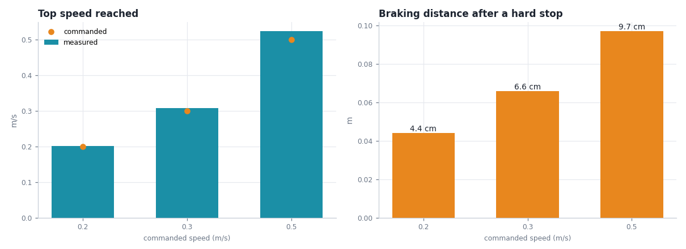
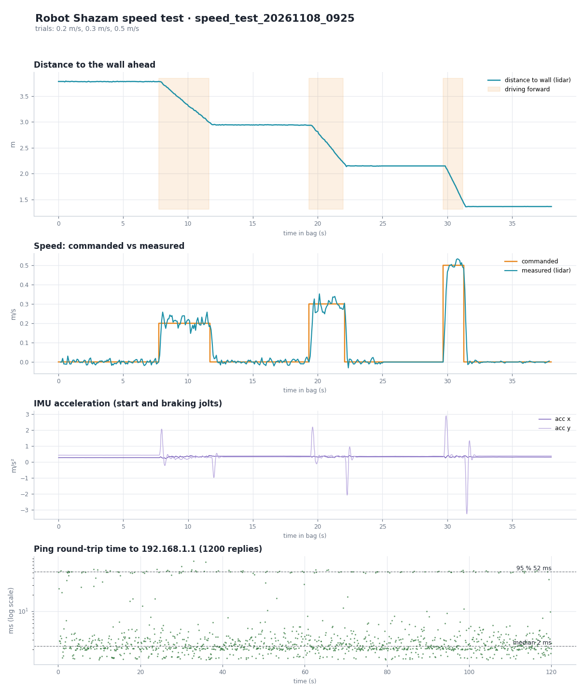
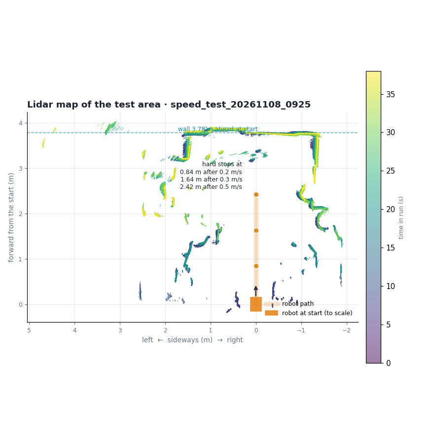

# Speed and hard-stop test, Nov 8 2026, run 2 (Robot Shazam / mecanum JetAuto)

Repeat of [run 1 (09:20)](../speed_test_20261108_0920) in the same hallway: straight runs at
**0.2, 0.3 and 0.5 m/s**, each about 0.8 m long and ended by a **hard stop**, with a
2-minute ping alongside. Method, topics and e-stop are described in the run 1 README.

| | |
|---|---|
| Date | Nov 8 2026, 09:26:04 (bag: 38.4 s, 9.5 MiB) |
| Battery | 11.47–11.54 V |
| Start | wall 3.78 m ahead, robot's lane clear for 3.18 m |
| Difference from run 1 | the robot did **not** reverse between runs (the lidar can't see behind it), so each run started where the previous one stopped: 0.84, 1.64 and 2.42 m from the start |

## Results

| Commanded | Measured (steady) | Peak | First motion (IMU) | Half speed reached | Braking distance | Time to standstill |
|---|---|---|---|---|---|---|
| 0.2 m/s | **0.201 m/s** (100 %) | 0.26 m/s | 0.17 s | 0.21 s | **4.4 cm** | 0.16 s |
| 0.3 m/s | **0.307 m/s** (103 %) | 0.35 m/s | 0.17 s | 0.24 s | **6.6 cm** | 0.20 s |
| 0.5 m/s | **0.523 m/s** (105 %) | 0.53 m/s | 0.15 s | 0.25 s | **9.7 cm** | 0.18 s |

Stops: braking starts 0.16–0.17 s after the stop command (IMU), half speed after 0.19–0.23 s.
Effective deceleration including that delay: 0.46 / 0.71 / 1.42 m/s²; IMU peak 1.3 / 2.2 / 3.3 m/s².
Full table: [`analysis/trials.csv`](analysis/trials.csv).

## Network (robot → Wi-Fi router, 1200 pings at 0.1 s)

| Sent | Lost | Median | 95 % | 99 % | Max |
|---|---|---|---|---|---|
| 1200 | **0 (0 %)** | 2.3 ms | 51.7 ms | 55.3 ms | 80.9 ms |

## Timeline

## Lidar map of the test area

## Files

Same layout as run 1: [`bag/`](bag), [`bag_info.txt`](bag_info.txt),
[`speed_test_log.txt`](speed_test_log.txt), [`analysis/`](analysis), [`graphs/`](graphs),
[`ping.txt`](ping.txt), [`logs/`](logs), [`code/`](code).
